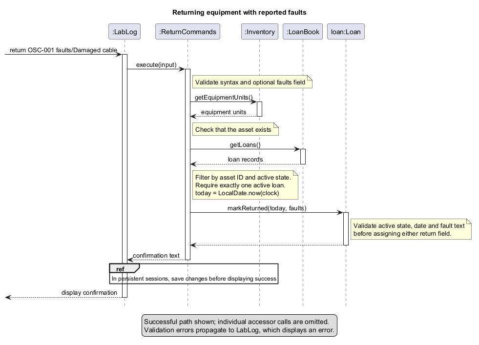
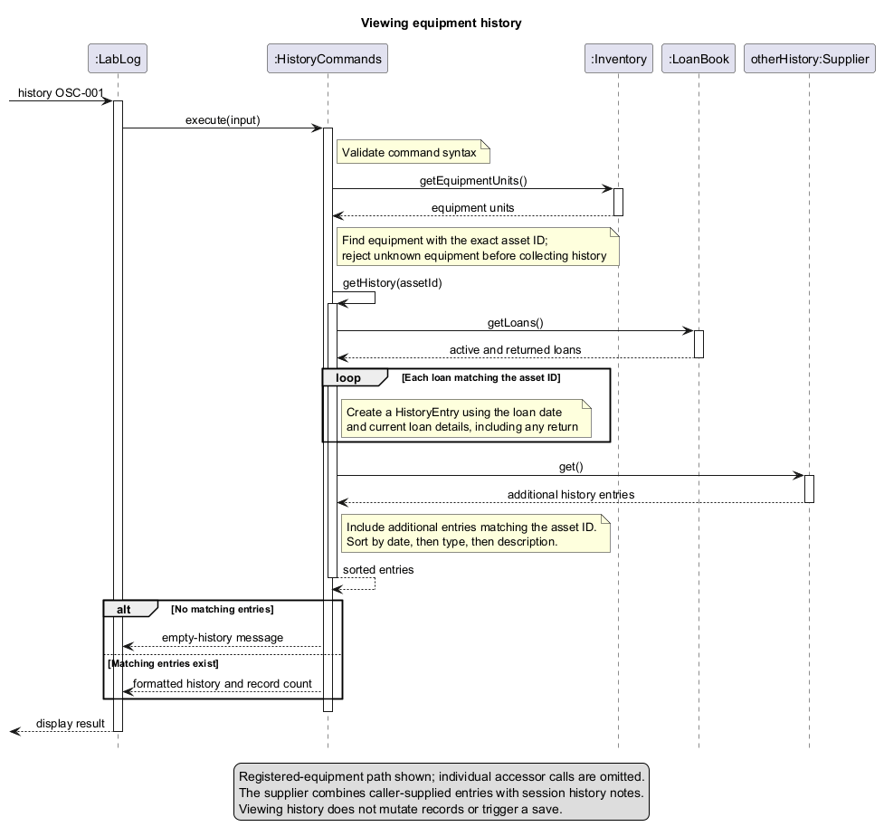

# Developer Guide

## Acknowledgements

LabLog builds on the SE-EDU Java project template. Gradle manages compilation,
JUnit 5 runs tests, Checkstyle checks coding conventions, and Shadow builds the
executable JAR. See `build.gradle` for dependency versions.

## Design & implementation

### Entry points and shared records

The production main entry point loads `LabLogStore` from `data/lablog.properties`
or the optional command-line file path. It stores equipment and complete loan
history in one versioned UTF-8 properties snapshot. Save to a temporary file
in the destination directory, then atomically replace the snapshot before
printing success. Unsupported atomic replacement is reported as a save failure;
there is no non-atomic fallback. Save failure stops the session to avoid further
unsaved operations. Borrower data is stored separately in a sibling
`borrowers.properties` file. Injected constructors remain in memory for unit tests.

Loading rejects missing required fields, invalid dates, duplicate IDs, unknown
equipment references, and multiple active loans per unit. A corrupt file is not
overwritten. This store assumes one application process owns a data file;
concurrent writers are not supported.

`LabLog` is the Gradle application entry point. It routes equipment registration
and copying, listing, active loans, history notes, help, loan, history, return,
and borrower commands to their handlers. The prompted and single-line equipment
registration forms both validate before storing. Borrower commands share the
main console's inventory and loan book. The CLI loads borrowers from the sibling
data file; in-memory constructors remain available for tests.

`BorrowerCli` is a separate entry point backed by a persistent `BorrowerBook`
and an initially empty `LoanBook`. `BorrowerCommands` handles registration,
loan listings, and help. The main application wires those handlers to shared
books; [borrower implementation notes](BorrowerImplementation.md) document the
standalone console and original integration increment.

`Equipment`, `Borrower`, and `Loan` model individual records. `Inventory`,
`BorrowerBook`, and `LoanBook` store collections. `LoanBook.findActiveLoan`
returns an `Optional<Loan>`; `hasActiveLoan` reports whether a matching active
loan exists. These are lookup helpers, not an enforcement mechanism:
`addLoan` still permits duplicate active loans, and the loan constructor does
not validate identifiers or dates. `LoanCommands` applies those checks before
storing a record; any other issuing path must repeat them.

### Equipment listing and filters

`EquipmentListCommands` accepts `list` with optional `category/`, `location/`,
and `status/` filters. Category and location compare as exact values without
case sensitivity, and combined filters use AND semantics. The handler filters
an immutable inventory snapshot, so results preserve registration order and do
not mutate shared records. Empty inventories and filters with no matches have
distinct messages; malformed, repeated, and unsupported filters are rejected.

Status follows the availability rule shared by the current loan and history
interfaces: a unit with an active loan is `on-loan`, and a unit without one is
`available`. Reservation and fault history entries are display notes and do not
change availability or prevent lending in this version. The handler reads
`LoanBook.hasActiveLoan` directly instead of keeping a second status field.

`EquipmentListCommandsTest` covers each filter, case-insensitive field values,
combined filters, status changes, invalid inputs, no matches, and the fact that
reservation and fault notes do not change loan-derived status.

### Copying equipment

`EquipmentCopyCommands` finds the source by its exact asset ID, rejects unknown
sources and IDs already in `Inventory`, then creates a new `Equipment` with the
source's descriptive fields and the requested ID. It receives only the shared
inventory, so it cannot copy loan or history records. `LabLog` saves a successful
copy through its existing snapshot store before reporting success.

`EquipmentCopyCommandsTest` covers copied fields, unique-ID and source checks,
the unchanged source, persistence, and keeping the original loan and history
records attached to the original ID.

### Help and command examples

`HelpCommands` contains shared guidance for both consoles and has no record
store dependencies. `help` returns a concise list; `help COMMAND` returns
syntax, fields, and explained examples. Invalid names and extra arguments
produce recoverable errors. The loan guidance requires borrower registration.

`HelpCommandsTest` checks parsing, examples against the real handlers, console
integration, and unchanged records/files when viewing help. `LabLogTest` checks
that unavailable commands and invalid initial input do not consume subsequent
commands as equipment details.

### Issuing loans

`LoanCommands` receives the shared inventory, loan book, and a `Clock`.
`loan ASSET_ID b/BORROWER_ID d/DUE_DATE` accepts the two prefixes in either
order, once each. It checks the syntax, that the unit is registered, that the
borrower ID is a single token, that the due date parses and is not in the past,
and last that the unit has no active loan. The record is stored only after every
check passes, so a rejected command never leaves a partial loan.

Availability is derived from `LoanBook.findActiveLoan` rather than a status field
on `Equipment`, so one place decides which units are out. The refusal names the
current borrower and due date, which is why the lookup returns the loan itself
rather than a boolean.

`LabLog` supplies its shared `BorrowerBook` to `LoanCommands`, which rejects
unregistered borrowers before recording a loan. The three-argument handler
constructor remains available to standalone callers with their own validation.

`LoanCommandsTest` covers the accepted command, prefix order, due dates at and
before today, malformed dates, missing and repeated fields, unknown equipment,
the refusal for a unit already out, and lending again after a return.

### Equipment returns

#### Implementation

`ReturnCommands` records returns using the shared `Inventory`, `LoanBook`, and
an injected `Clock`. It updates the existing `Loan` rather than removing it,
so the same record remains available to equipment history and borrower listings.

The command formats are:

```text
return ASSET_ID [faults/DESCRIPTION]
return ASSET_ID ASSET_ID ...
```

Multiple asset IDs are separated by whitespace and must be distinct. The optional
`faults/` field is accepted only for a single unit; units with newly reported
damage must be returned individually to associate each description with the
correct loan.

The main operations are:

* `ReturnCommands#readAssetIds(selection)` parses the equipment selection, preserves
  input order, and rejects repeated IDs.
* `ReturnCommands#findActiveLoan(assetId)` checks that equipment exists and finds
  exactly one matching active loan, rejecting missing or inconsistent records.
* `ReturnCommands#execute(input)` resolves all selections and validates every loan
  before starting a separate update pass.
* `Loan#validateReturn(returnDate, faults)` checks the active state, return date,
  and fault text without changing the loan. Its package access lets the handler
  validate a batch before applying any returns.
* `Loan#markReturned(returnDate, faults)` calls the same validation method before
  assigning the return fields. The one-argument overload records a return without
  reported faults.
* `Loan#isActive()` reports whether the return date is absent. Recording a return
  makes the loan inactive without changing a separate equipment status field.

`LabLog` normally supplies `Clock.systemDefaultZone()`. Tests can inject a fixed
clock to control today's local date and verify time-zone boundaries.

#### Example usage scenario

Assume `OSC-001` is registered and has exactly one active loan whose loan date
is no later than today.

1. The user enters `return OSC-001 faults/Damaged cable`.
2. `LabLog` dispatches the command to `ReturnCommands#execute`. The handler
   validates the syntax and optional fault description, then checks the inventory
   for the exact asset ID.
3. The handler reads `LoanBook#getLoans()` and filters for matching active loans.
   It proceeds only when exactly one is found.
4. The handler obtains `LocalDate.now(clock)` and calls
   `Loan#validateReturn(today, faults)` in the validation pass. It then calls
   `Loan#markReturned(today, faults)` in the update pass to record the date and
   fault description.
5. The handler returns confirmation text. In a persistent CLI session, `LabLog`
   saves the updated records before displaying success. If saving fails, the
   session stops and the previous saved snapshot remains unchanged; the in-memory
   loan has already been updated. Injected in-memory sessions do not save.
6. A subsequent history request shows the return date and reported faults on the
   original loan entry. Active-loan and borrower-loan listings exclude that loan.

The following sequence diagram summarises the successful single-unit return
path. Parsing, the preliminary validation pass, and individual accessor calls
are omitted for readability; `markReturned` also validates before updating.



Editable diagram source: [ReturnEquipment.puml](diagrams/ReturnEquipment.puml).

#### Batch return flow and atomicity

For `return OSC-001 OSC-002`, the handler performs the following steps:

1. Parse the distinct asset IDs and reject any `faults/` field accompanying
   multiple selections.
2. Resolve every ID to exactly one active loan. An unknown unit or an already
   returned loan causes rejection before any record is changed.
3. Read today's date once using the injected clock and validate every selected
   loan against that date and an empty fault description.
4. Only after the whole selection passes validation, call `markReturned` on each
   selected loan using the same date. Unselected and historical loans are retained.
5. Return confirmation listing the selected asset IDs in input order. In a
   persistent session, `LabLog` saves the complete equipment and loan snapshot
   before displaying that confirmation.

Validation is all-or-nothing: a failure on a later selection leaves earlier
selections unchanged. This relies on the application's single-threaded command
execution, with no concurrent changes between validation and mutation.

Persistence uses one atomic snapshot replacement for the complete batch. If the
save fails, the prior saved file remains unchanged and the session stops without
displaying success. The in-memory loans have already been updated; there is no
in-memory rollback on a storage failure. Restarting reloads the prior saved state.

#### Invalid commands and exceptional cases

| Condition | Behaviour |
| --- | --- |
| Missing asset ID or unsupported arguments | Reject the command with usage guidance. |
| Repeated asset ID in the selection | Identify the duplicate and reject the entire batch. |
| `faults/` supplied with multiple asset IDs | Ask the user to return units with reported faults individually. |
| Empty or repeated `faults/` field | Request one non-empty fault description. |
| Equipment does not exist | Report that the equipment was not found. |
| No matching active loan | Report that the equipment is not currently on loan. |
| Multiple matching active loans | Ask the user to resolve the inconsistent loan records. |
| Return date precedes the loan date | Reject the return without changing its fields. |
| Fault text contains control characters | Reject the return without changing its fields. |

`LabLog` catches validation exceptions and displays an error while allowing the
user to continue. A repeated return is rejected when no active loan remains.
For batches, any validation failure preserves all selected loans' existing
details. A save failure occurs after the valid returns have already updated memory.

#### Design considerations

**Aspect: How returns are stored**

* **Current choice: Update the existing loan.** Borrowing and return details stay
  together, and history and active-loan listings read the same records. This
  represents one return per loan rather than a detailed sequence of return events.
* **Alternative: Store separate return records.** This could support a richer
  event history, but requires links and consistency checks between loans and
  returns.

**Aspect: How the return date is obtained**

* **Current choice: Inject a `Clock`.** This makes date-dependent tests repeatable,
  including tests around local-date boundaries, at the cost of an extra dependency.
* **Alternative: Read the system date directly.** This needs less configuration,
  but makes date-dependent tests harder to control.

**Aspect: How batch failures are handled**

* **Current choice: Validate all selections before applying any returns.** The
  user can correct a rejected command without first checking which units were
  already returned. Reusing `Loan#validateReturn` keeps the batch's checks aligned
  with `markReturned`.
* **Alternative: Return valid units and skip invalid selections.** This can make
  partial progress, but needs per-unit outcomes and more care when retrying a
  command. A single rejection would no longer mean that all records are unchanged.

Reported faults are stored as text on the loan. They do not create a separate
fault-history note or clear existing equipment faults. The production application
persists loan and return details through `LabLogStore`.

#### Testing

`ReturnCommandsTest` covers optional faults, local-date boundaries, malformed
commands, repeated returns, multiple active loans, invalid return dates, historical
loans, borrower-listing updates, and the return/history console flow. Batch tests
use JUnit assertions to check successful returns, duplicate selections, rejection
of batch fault descriptions, and unchanged records when a later selection has a
future loan date or has already been returned. They verify return fields and
retained records as well as exception messages where relevant.

`LabLogStoreTest#run_batchReturn_persistsBothReturnsAfterReload` drives the return
through the main console with a temporary data file. It reloads the saved store
and verifies both return dates, retained loan fields, and equipment history.

### Equipment history

#### Implementation

`HistoryCommands` reads the shared `Inventory` and `LoanBook`, then constructs fresh
history entries on every request. Both active and returned loans are included.

The command format is:

```text
history ASSET_ID
```

The main operations and records are:

* `HistoryCommands#execute(input)` validates the command, locates the equipment,
  and formats the result.
* The private `HistoryCommands#getHistory(assetId)` collects, filters, and sorts
  entries without modifying the source records or their ordering.
* `HistoryEntry` holds an asset ID, date, type, and description for display.
* `Supplier<List<HistoryEntry>>` supplies current entries from other features.

Returned-loan descriptions include the return date and reported faults, or state
that no faults were reported on return. Asset IDs are matched exactly and
case-sensitively.

#### Example usage scenario

Assume `OSC-001` has a loan that has been returned with the fault description
`Damaged cable`.

1. The user enters `history OSC-001`.
2. `LabLog` dispatches the command to `HistoryCommands#execute`. The handler
   validates the syntax and locates the equipment in `Inventory`.
3. The handler reads the shared loan book and creates an entry for each matching
   loan. Each entry uses the loan date and reflects the loan's current state,
   including the return date and fault description.
4. The handler calls the additional-history supplier and includes entries with
   the same asset ID. In `LabLog`, this supplier combines caller-supplied entries
   with session notes from `HistoryRecordCommands`.
5. The handler sorts the combined entries by date, oldest first. Ties are broken
   by enum type order (`LOAN`, `RESERVATION`, `FAULT`, `MAINTENANCE`), then by
   description.
6. The application displays the equipment ID and name, the `Date | Type | Details`
   rows, and the record count. No save is triggered by viewing history.

The following sequence diagram shows a history request for registered equipment.
Individual field accessors are omitted for readability.



Editable diagram source: [EquipmentHistory.puml](diagrams/EquipmentHistory.puml).

A malformed command is rejected with usage guidance. Unknown equipment produces
an error before history is collected. Registered equipment with no matching
records produces `No history found for ASSET_ID - NAME.` instead.

#### Integration with other features

`HistoryRecordCommands` creates structured faults and reservation/maintenance notes. Other
features can also supply snapshots through `Supplier<List<HistoryEntry>>`. The
supplier must return a non-null list and must not duplicate loans already read
from `LoanBook` or faults already read from `FaultBook`. It should read current records on every call, include relevant
status and end dates in descriptions, and retain closed or cancelled records when
appropriate. Entries may cover multiple assets; the handler filters them.

Use the loan date, reservation start date, fault report date, or maintenance date
as the entry date. Returning equipment changes the original loan entry's
description; it does not add a separate entry dated on the return day.

Shared records can be passed through
`new LabLog(inventory, loanBook, () -> currentHistoryEntries)`, or directly to
`HistoryCommands`. The application combines supplied entries with session notes.
These notes do not affect equipment availability and are not persisted, whereas
loan and return records are persisted in production CLI sessions.

#### Design considerations

**Aspect: When history is constructed**

* **Current choice: Build entries on each request.** Returns and source updates
  appear immediately without synchronising a separate cache. Each request scans
  the source records and sorts matching entries.
* **Alternative: Cache the combined history.** This could reduce repeated work,
  but every relevant record change would need to update or invalidate the cache.

**Aspect: How other features contribute history**

* **Current choice: Accept supplied `HistoryEntry` snapshots.** The handler can
  display other features' records without depending on their internal models.
  Suppliers must follow the entry contract and avoid duplicate loan entries.
* **Alternative: Read each feature's model directly.** This gives direct access
  to its details, but adds dependencies whenever new record types are introduced.

History summarises current records; it is not an immutable audit trail of every
change. Rebuilding entries makes updated details visible, but does not preserve
previous versions of those details.

#### Testing

`HistoryCommandsTest` covers all four entry types, asset filtering, returned
loans, fresh source updates, date ordering and tie-breaking, malformed input,
empty and unknown equipment, and console integration with shared records.

## Product scope
### Target user profile

Laboratory technicians managing individual electronics equipment units and
student borrowers through a text interface.

### Value proposition

Keep equipment identity, borrower contacts, and loan history accessible from
the command line. The main console shares records across registration, lending,
returns, and lookups.

## User Stories

|Version| As a ... | I want to ... | So that I can ...|
|--------|----------|---------------|------------------|
|v1.0|new user|see usage instructions|refer to them when I forget how to use the application|
|v1.0|laboratory technician|register borrowers|retain validated contact details|
|v1.0|laboratory technician|view active loans and equipment history|track who has equipment and its past loans|
|v1.0|laboratory technician|record returns and reported damage|close loans while retaining their history|
|v2.0|laboratory technician|return multiple equipment units in one operation|process a group of returns without repeating the command|

## Non-Functional Requirements

Build and run with Java 25. Keep help read-only and reject invalid borrower and
return commands before changing records. Save borrower additions atomically
before updating memory. These behaviors are covered by automated tests.

Current limitations: the standalone borrower console has its own initially
empty loan book; reservation and maintenance history notes are held only
for the session; and concurrent writers to the same data files are unsupported.
Return fault descriptions are stored in loan history and do not create a
separate fault note.

## Glossary

* **Asset ID:** identifier of one physical equipment unit.
* **Active loan:** a loan whose return date is absent.
* **Overdue loan:** an active loan with a due date before today's local date.
* **History entry:** a display snapshot of a record, not an immutable event log.

## Instructions for manual testing

### Assertions and diagnostic logging

`LabLog` uses Java `assert` statements to check internal assumptions: only
supported record commands reach its dispatch helper, and equipment detail
collection receives an already validated asset ID. User input errors still use
normal validation, which works even when assertions are disabled.

`HelpCommands` and `LabLog` use `java.util.logging` at `FINE` level to trace help
requests, rejected input, and incomplete registration. Logs omit raw input and
borrower details. Enable assertions and console diagnostics from the repository
root after building the JAR:

```powershell
java -ea -Djava.util.logging.config.file=config/logging.properties -jar build/libs/lablog.jar
```

Enter `help`, `help unknown`, a blank line, and `exit` to see diagnostics on
standard error alongside the usual console output. Without the logging option,
the default Java logging configuration hides `FINE` messages. Gradle's test task
enables assertions by default.

### Automated and manual checks

From the repository root with Java 25:

```powershell
.\gradlew.bat test checkstyleMain checkstyleTest shadowJar
python test/run-cli-smoke-tests.py
```

The Python 3 runner checks the packaged JAR and separate borrower processes with
temporary data. The existing PowerShell 7 runner also verifies exact borrower
output: `pwsh -File test/run-borrower-ui-tests.ps1`. See the
[console test plan](../test/ui-test-plan.md) and
[verification report](../test/verification-report.md).

For a manual main-console check, run `java -jar build/libs/lablog.jar` with a
disposable data-file path, register equipment with `add`, register a borrower
with `add-borrower`, then issue a loan. Check `active-loans`, `loans
BORROWER_ID`, `return ASSET_ID`, and `history ASSET_ID`. Restart with the same
data path to confirm equipment, loans, returns, and borrowers reload. Use a
separate disposable directory because borrower data is stored beside the
LabLog data file.

## Equipment detail editing (issue #62)

EquipmentEditCommands parses optional name, category, model, and location fields
and constructs a fully validated immutable Equipment record. Inventory replaces
the record at its existing position while retaining the same asset ID, so loan
and history references remain valid. LabLog saves the updated equipment through
the existing snapshot store after the command succeeds.

EquipmentEditCommandsTest covers partial edits, field ordering, validation,
stable asset references, and persistence after restart.

## Bulk equipment location updates (issue #64)

EquipmentMoveCommands parses a comma-separated selection and one target
location. Inventory validates every distinct asset ID and constructs all
replacement Equipment records before installing any of them, so an invalid
selection or location leaves the batch unchanged. LabLog then persists the
updated inventory through the existing snapshot store.

EquipmentMoveCommandsTest covers successful partial batch updates, validation
atomicity, stable loan references, and persistence after restart.

## Exact equipment lookup (issue #67)

EquipmentFindCommands resolves one case-sensitive asset ID from the shared
inventory and reports descriptive fields with availability derived from active
loans and severe faults. The lookup is read-only and returns a clear error for unknown IDs.

EquipmentFindCommandsTest covers details, availability, invalid syntax,
unknown IDs, and unchanged equipment and loan records.

## Borrower contact editing (issue #89)

BorrowerCommands parses optional edit fields and constructs a validated immutable
Borrower. BorrowerBook.updateBorrower requires an existing ID and persists a
proposed map before publishing the replacement. Loans refer to IDs, so edits do
not require rewriting loan records. The package-level Saver boundary lets the
main application later save proposed contacts with its complete snapshot.

BorrowerEditTest covers partial/reordered edits, name-length boundaries,
unchanged loan objects, restart persistence, invalid fields, and failed saves.

## Versioned export schema (issue #90)

ApplicationSnapshot captures the supported object graph and uses LabLogStore's
equipment/loan serializer. UTF-8 properties format 5 retains borrower.count and
note.count with indexed fields. audit.count is explicitly zero until an audit
domain schema exists. The codec validates references and dates before writing
a temporary file and atomically replacing its destination. The export command
requires a new file and protects the active data paths.

Integration contract for domain owners: add full serialization, validation and
round-trip tests for new reservation/audit models, then bump the version.
Do not serialize HistoryEntry display text as a substitute for full domain data.
Import CLI integration follows in issue #91; envelope hardening is issue #92.

## Import and single-file persistence (issue #91)

LabLog.load reads format 2 into detached books, or loads the legacy two-file
installation without writing during startup. Main-console mutations persist
one ApplicationSnapshot. BorrowerBook's Saver writes proposed contacts with
the other current records before publishing the edit.

Import decodes all records and validates IDs, references, dates and active-loan
constraints before writing the replacement atomically. Only after persistence
succeeds does it replace the contents of shared books. Existing command handlers
therefore observe the new records without being rebuilt. Injected external
history sources cannot be replaced and are rejected explicitly.

SnapshotImportTest checks valid replacement, visibility through existing
handlers, restart, updated contacts, legacy migration and a failed destination
replacement. An unsupported atomic move fails safely; no non-atomic fallback
is attempted. Use one main-console process per data file.

## Import envelope validation (issue #92)

ApplicationSnapshot.readProperties rejects duplicate properties through a
Properties subclass instead of accepting the parser's usual last-value-wins
behavior. It checks regular-file status and the 10 MiB input limit. Decode
derives the accepted key set from the export schema and rejects supplied keys
outside it, including out-of-range indices. The error names the first unknown
key in sorted order. Required-field validation separately rejects missing keys. Domain validation remains shared with
the export codec.

SnapshotValidationTest supplies malformed versions, counts, contact fields,
dates, references, duplicate IDs/keys, unknown fields, unsupported audit data,
invalid UTF-8 and oversized input. Dispatcher-level cases verify saved content
and active-loan listings remain unchanged after each invalid import.


The PR #96 follow-up is covered by
SnapshotValidationTest.decode_unknownProperties_rejectsBeforeReserialization.
It supplies valid format-2 records plus unknown top-level, per-record and
out-of-range indexed properties. Both direct decode and read-then-write must
fail before the existing destination can be overwritten; the source, destination
and input properties are checked for preservation.

## Explicit command recall (issue #93)

CommandHistory intercepts commands and recall before normal dispatch. It keeps
at most 20 submitted top-level lines and returns display text without recursively
dispatching the recalled command. Scanner-based consoles do not support portable
editable terminal buffers, so copying/editing and explicit resubmission is the
documented interaction. No terminal dependency or hidden execution is needed.

CommandHistoryTest covers empty history, invalid/overflowing indices, eviction,
session isolation, wizard-answer exclusion, both consoles and explicit execution
after editing a recalled command.

### Sorting filtered equipment

Use `list [category/VALUE] [location/VALUE] [status/available|on-loan] [sort/FIELD]`.
Filtering and sorting can be combined in any order. Sort fields are `asset-id`,
`name`, `category`, `model`, `location`, and `availability`. For example,
`list category/Electronics sort/name` sorts only matching units. Comparisons
are ascending and case-insensitive, with asset ID and exact ID case as tie-breakers.
Sorting a copied snapshot preserves the stored registration order.

## Structured fault reports (issue #85)

`Fault` holds an immutable ID, registered asset ID, report date and description.
`FaultBook` owns the records and checks equipment references and duplicate IDs.
Reports use UUID-based `F-...` IDs to avoid a separate persistent counter.
`getFaults()` returns an immutable snapshot for future overview consumers;
`Fault.toHistoryEntry()` includes the ID without storing duplicated history text.
Issues #86 and #87 add severity, lending restrictions and repair transitions below.

`HistoryRecordCommands` retains the existing fault command syntax and date rules
(including past and future dates). `LabLog` shares the store's fault book and saves
before printing success. A save failure stops the session using the existing
failure policy; the previous saved data remains unchanged.

Live data format 3 adds `fault.count` and indexed `fault.N.id`, `asset`, `date`
and `description` fields. Format 1 live files load with an empty fault book and
upgrade on the next save. Borrowers retain their existing separate live file.
Export format 3 includes the same fault fields alongside borrowers and notes.
The export reader also accepts format 2, retaining legacy fault notes as notes;
no import command or automatic conversion of exported notes is introduced here.
Derived fault history is excluded from exported notes to prevent duplication.

`FaultReportingTest` covers multiple reports, date boundaries, invalid input,
immutable views, stable IDs across restart/export, broken saved references,
duplicate IDs, legacy loading, and failed-save behavior.

## Fault severity and description (issue #86)

`Fault.Severity` defines `MINOR`, `MODERATE`, `SEVERE` and `UNSPECIFIED`. The
optional `s/` field accepts the first three levels case-insensitively, between
`d/DATE` and `desc/DESCRIPTION`. Omission retains the original command syntax
and records `UNSPECIFIED`. Descriptions remain required and single-line; repeated
or misplaced field prefixes are rejected before any record is inserted.

The agreed lending rule blocks equipment with a severe fault. `FaultBook`
provides an immutable `getUnresolvedSevereFaults()` snapshot for US58 and
`blocksLending(assetId)` for loan validation and availability displays. Resolved
faults are excluded from this query. Severity blocks immediately, independent of the report date. Existing
loans and returns remain valid; a return does not resolve a fault.

`LabLog` supplies the same fault book to reporting, loan, list and find handlers.
`LoanCommands` rejects severe faults before adding a loan. Listings show `On loan`
for active loans, otherwise `Unavailable: severe fault` for affected units.
Overview presentation is not implemented by this change; repairs are described below.

Live and export format 4 adds required `fault.N.severity` enum names. Live
formats 1 and 3 and export formats 2 and 3 remain readable. Format 3 faults
migrate to `UNSPECIFIED`, preserving IDs, dates and descriptions. Missing or
unknown severity in format 4 or later is corruption, not a migration default.
The current writer uses format 5 as described below.

`FaultSeverityTest` covers all levels, description validation, immutable overview
results, affected-unit isolation, date boundaries, reports during active loans,
return behavior, restart/export preservation, migration and malformed severity.

## Fault repairs and resolution (issue #87)

`RepairCommands` accepts `repair FAULT_ID d/YYYY-MM-DD desc/DETAILS`. Its injected
clock checks that the date is not in the future in the application's local time
zone. `Fault.resolve` rejects repeat resolution, a date before the report, or
empty/multiline details. It returns a new immutable `Fault`, preserving the report
ID, equipment ID, report date, description and severity. `FaultBook.resolve`
replaces the matching record only after validation succeeds; existing snapshots
retain their original values. Unknown IDs never change the book.

Resolution state is derived from the optional resolution date; an unresolved
record has no date and empty repair details. A resolved record requires both.
There is one terminal unresolved-to-resolved transition. Reopening, editing a
repair and multiple repair attempts against the same fault are outside scope.

`Fault.toHistoryEntries()` returns the unchanged report entry and, after
resolution, a separate `MAINTENANCE` entry on the repair date, linked by fault ID.
`HistoryRecordCommands` supplies these entries to the existing chronological
history display. The overview query excludes resolved severe faults, so loan,
list and find handlers see updated availability immediately without cached state.
Other unresolved severe faults and active loans continue to prevent lending.

`LabLog` saves a repair before printing success. Save failure stops the session
under the existing persistence policy, leaving the prior saved state unchanged.
Live/export format 5 adds required `fault.N.resolved` and `fault.N.repair` fields;
both are empty for unresolved reports. Resolved records store an ISO date and
non-empty single-line details. Decoding rejects missing fields, partial repairs,
invalid dates and resolution dates before the report. Current-date validation
belongs to the command, not loading, so saved history is independent of the clock.
Live formats 1, 3 and 4 and export formats 2, 3 and 4 remain readable. Older fault
records become unresolved without losing their existing fields. Export stores
domain fields only, avoiding duplicate report/repair notes. Older versions of
the application cannot read format 5.

`RepairCommandsTest` covers successful and same-day repairs, immutable original
reports, rejected inputs and transitions, local-date boundaries, multiple severe
faults, active loans, chronology, restart/export, migration, corrupt repairs and
failed saves. Existing equipment-editing tests also verify integration with the
current develop branch.
