# Developer Guide

## Table of contents

* [Acknowledgements](#acknowledgements)
* [Setting up and getting started](#setting-up-and-getting-started)
* [Design](#design)
  * [Architecture](#architecture)
  * [How a command is executed](#how-a-command-is-executed)
  * [Model](#model)
  * [Storage](#storage)
* [Implementation](#implementation)
  * [Equipment records](#equipment-records)
  * [Borrowers](#borrowers)
  * [Loans](#loans)
  * [Loan audit trail and corrections](#loan-audit-trail-and-corrections)
  * [Equipment history](#equipment-history)
  * [Faults and repairs](#faults-and-repairs)
  * [Reservations and availability](#reservations-and-availability)
  * [Daily overview, help and command recall](#daily-overview-help-and-command-recall)
* [Documentation, logging and testing](#documentation-logging-and-testing)
* [Appendix A: Product scope](#appendix-a-product-scope)
* [Appendix B: User stories](#appendix-b-user-stories)
* [Appendix C: Non-functional requirements](#appendix-c-non-functional-requirements)
* [Appendix D: Glossary](#appendix-d-glossary)
* [Appendix E: Instructions for manual testing](#appendix-e-instructions-for-manual-testing)
* [Appendix F: Known limitations](#appendix-f-known-limitations)

## Acknowledgements

LabLog builds on the SE-EDU Java project template. Gradle manages compilation,
JUnit 5 runs tests, Checkstyle checks coding conventions, and Shadow builds the
executable JAR. See `build.gradle` for dependency versions.

## Setting up and getting started

1. Install JDK 25 and clone the repository.
2. Open the project in IntelliJ IDEA as a Gradle project and set the project SDK to JDK 25.
3. Run `.\gradlew.bat run` (Windows) or `./gradlew run` (macOS/Linux) to start the
   main console. Gradle enables Java assertions for both `run` and `test`.
4. Run `.\gradlew.bat test checkstyleMain checkstyleTest` before pushing.
5. Build the executable JAR with `.\gradlew.bat shadowJar`; it is written to
   `build/libs/lablog.jar`.

**Diagrams in this guide** are inline Mermaid blocks, so each diagram can be
edited beside its explanation. They follow the UML notation in the course
textbook. Sequence diagrams name instances `:Class`, use solid arrows for calls
and dashed arrows for returns, and mark static method calls with `«class»`. Class
diagrams write members as `name: Type`, show composition with a filled diamond at
the whole, and draw each association as a line rather than also as an attribute.
Object diagrams underline `name:Class` and list `attribute = value`.

## Design

### Architecture

The architecture diagram gives a top-down view of LabLog. Arrows mean "uses".

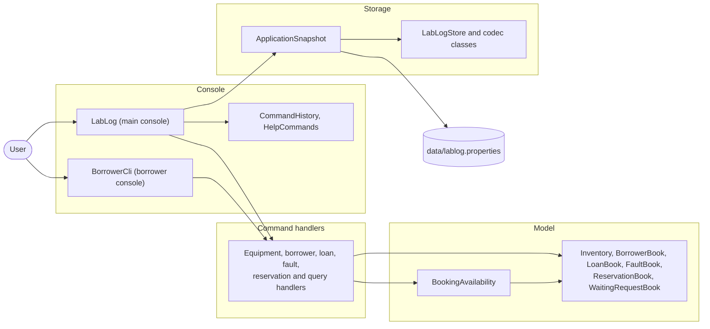

| Component | Main classes | Responsibility |
| --- | --- | --- |
| Console | `LabLog`, `BorrowerCli`, `CommandHistory`, `HelpCommands` | Read input, route each command, save after changes and print results or errors. |
| Command handlers | `EquipmentListCommands`, `LoanCommands`, `ReturnCommands` and the other `*Commands` classes | Parse one command family, validate it and call the model. |
| Model | Books such as `Inventory` and `LoanBook`; records such as `Equipment` and `Loan`; `BookingAvailability` | Hold the live records and enforce rules that span records. |
| Storage | `ApplicationSnapshot`, `LabLogStore`, `LoanAuditCodec`, `LoanRenewalCodec`, `ReservationCodec`, `WaitingRequestCodec` | Convert all records to and from one validated properties file. |

All classes live in the `lablog` package. `LabLog` is the main entry point. It
creates one instance of each book and passes the same instances to every handler,
so a change made by one command is visible to the next command without copying.
`BorrowerCli` is a smaller, standalone console for borrower records only.

### How a command is executed

Every command follows the same path through `LabLog`. The sequence below uses
`copy OSC-001 OSC-002` as an example of a command that changes records.

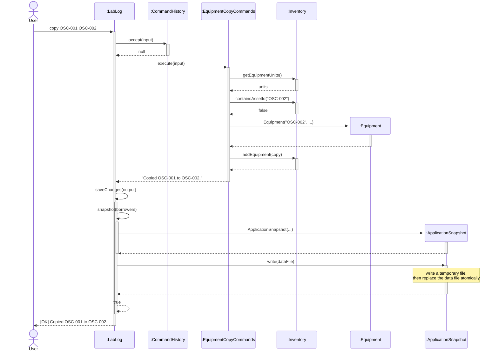

1. `CommandHistory` first handles `commands` and `recall INDEX`. It returns `null`
   for other input, so `LabLog` routes the input by its first word.
2. The handler validates the whole command before changing any record. Invalid
   input throws `IllegalArgumentException`; `LabLog` prints `Error: ...` and the
   session continues.
3. Commands that change records are saved before success is printed with the
   `[OK]` prefix supplied by `Messages.ok`. Read-only
   commands such as `list`, `find`, `history` and `loan-audit` never save.

The feature diagrams later in this guide start at the call from `:LabLog` to the
handler and leave out these shared steps.

### Model

Books own the live collections. Records are immutable, except `Loan`, whose
return, renewal, loss and reversal state changes over time.

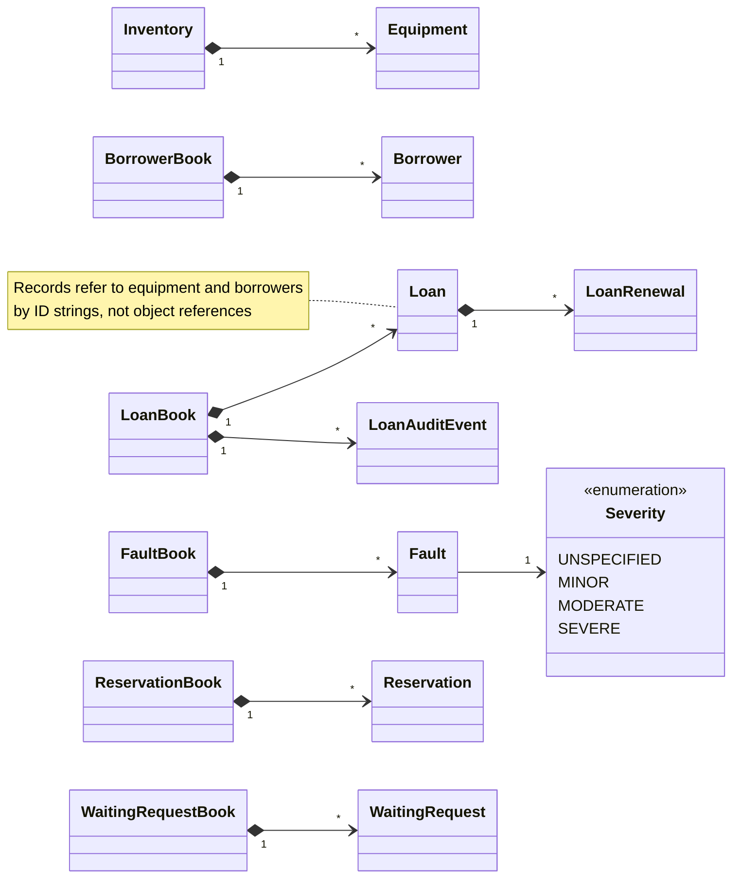

* `Loan` stores an asset ID and a borrower ID. Editing a borrower's contact
  details or an equipment's location therefore never rewrites loans.
* `LoanAuditEvent` records are immutable evidence of loans, returns and their
  corrections, kept beside the mutable `Loan` records.
* `BookingAvailability` is the single date-range conflict policy that reads the
  books; see [Reservations and availability](#reservations-and-availability).
* Each book returns an unmodifiable list, so callers cannot add or remove records
  without going through the book's checks.

### Storage

**One snapshot file.** The main console stores everything in one UTF-8 Java
properties file, `data/lablog.properties` by default, or the path given as the
only command-line argument. `ApplicationSnapshot` holds equipment, borrowers,
loans, renewals, losses, audit events, notes, faults, repairs, reservations and
waiting requests. Each record uses indexed keys such as `loan.0.asset`, and a
`*.count` key gives the number of records of each type.

**Format versions.** The `format` key records the schema version. The current
writer always saves format 11. Each version added one kind of record:

| Format | Added | Format | Added |
| --- | --- | --- | --- |
| 2 | Complete snapshot of equipment, loans, borrowers and notes | 7 | Reservation cancellation |
| 3 | Fault reports | 8 | Waiting requests |
| 4 | Fault severity | 9 | Loan renewal chains |
| 5 | Repairs and fault resolution | 10 | Loss reports |
| 6 | Reservations | 11 | Stable loan IDs and the loan audit log |

Formats 2 to 10 still load. Missing newer data is never invented: for example, a
format-8 file loads with no renewals, and a format-10 file loads with an empty
audit log and fresh loan IDs. Older installations that kept equipment/loans and
borrowers in two separate files are loaded through `LabLogStore` and migrated to
one snapshot on the next save.

**Validation before use.** Loading and importing reject, before any live record
changes:

* files that are not regular files or exceed 10 MiB, and repeated property keys;
* unsupported formats, missing required fields and keys unknown to the declared
  format, so a newer feature's data is never silently dropped on re-save;
* invalid dates, duplicate IDs, references to unknown equipment or borrowers, and
  more than one active loan per unit;
* renewal chains, loss dates and audit events that contradict the loan records.

A corrupt data file stops startup instead of being overwritten.

**Atomic saving.** `ApplicationSnapshot.write` writes a temporary file in the
destination directory, then replaces the destination with an atomic move. If the
file system cannot move atomically, saving fails; there is no non-atomic fallback.
The previous file therefore stays intact after any failed save.

**Two save strategies.** Commands save in one of two ways:

| Strategy | Used by | If saving fails |
| --- | --- | --- |
| Save, then publish: the book passes the proposed collection to an injected `Saver` and updates memory only after it succeeds | Borrowers, reservations, waiting requests, import | An error is printed, nothing changes and the session continues. |
| Update, then save: the handler changes the shared books, then `LabLog.saveChanges` writes the snapshot | All other commands that change records | The session stops so no further unsaved work is accepted. The file keeps the last saved state; memory is not rolled back, so restart to reload it. |

The second strategy keeps handlers simple. It is safe because the session stops
at the first failed save.

**Export and import.** `export FILE` writes a complete snapshot to a new file and
refuses existing files or the live data paths. `import FILE --replace` decodes and
validates the whole file, saves it as the live data file, then replaces the
contents of every book. The books keep their identities, so every handler sees the
imported records immediately.

**Limitation.** One main-console process should own a data file. Atomic replacement
does not lock the file or merge changes from concurrent processes.

## Implementation

This section describes how each feature area works and why it was designed that
way. [Appendix B](#appendix-b-user-stories) lists the user stories these
features implement.

### Equipment records

An `Equipment` record is immutable and identified by a case-sensitive asset ID.
`Inventory` keeps units in registration order and rejects duplicate IDs.

| Command | Handler | Behaviour |
| --- | --- | --- |
| `add ASSET_ID` | `LabLog` | Prompts for name, category, model and location. `cancel` aborts; end of input discards the unit. |
| `add ASSET_ID n/NAME c/CATEGORY m/MODEL l/LOCATION` | `EquipmentAddCommands` | Single-line registration with the same validation. |
| `copy SOURCE NEW` | `EquipmentCopyCommands` | Copies descriptive fields to a new ID. Loans and history stay with the source. |
| `edit-equipment ASSET_ID [n/] [c/] [m/] [l/]` | `EquipmentEditCommands` | Builds a validated replacement and puts it at the same position with the same ID. |
| `move-equipment ID[,ID...] l/LOCATION` | `EquipmentMoveCommands` | `Inventory.updateLocations` validates every ID and builds every replacement before installing any of them. |

Because loans, faults and history refer to asset IDs, editing or moving a unit
leaves every reference valid.

#### Availability status

`list`, `find` and `search` derive a unit's current status from the live books.
Nothing is cached, so the status is always up to date. The first matching rule wins:

1. `Lost`: the unit has an outstanding loan reported lost.
2. `On loan`: the unit has another active loan.
3. `Unavailable: severe fault`: the unit has an unresolved severe fault.
4. `Available`: none of the above.

This is the status today, not a booking guarantee. Reservations do not change
it; use `available` or `why-unavailable` for a date range.

#### Listing, filtering and sorting

`list [category/VALUE] [location/VALUE] [status/STATUS] [sort/FIELD]` accepts each
option at most once, in any order. Category and location match exact values
ignoring case; combined filters use AND. `status/` accepts `available`, `on-loan`,
`unavailable` or `lost`. `sort/` accepts `asset-id`, `name`, `category`, `model`,
`location` or `availability`, ascending and case-insensitive, with the asset ID as
tie-breaker. The handler filters and sorts a copy, so inventory order never
changes. All options are validated even when the inventory is empty.

#### Exact lookup and partial search

`find ASSET_ID` shows one unit by its exact, case-sensitive ID. `search TEXT`
complements it when only part of a name or model is remembered: `search scope`
matches both "Digital Oscilloscope" and a model named "ScopeMate". Search checks
names and models only.

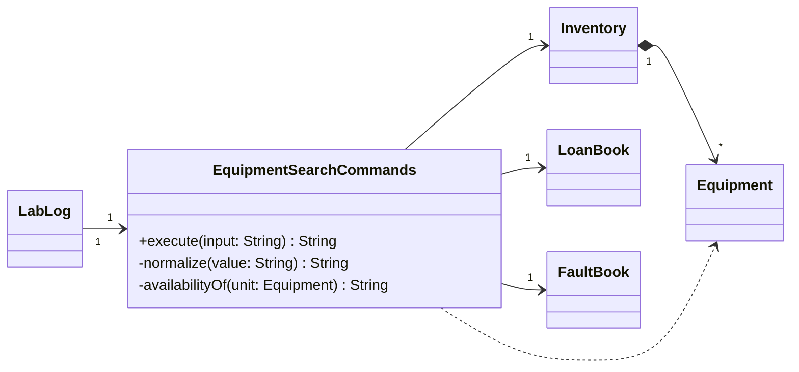

The handler owns no records and keeps no search index. It collapses whitespace and
lower-cases both the query and each field with `Locale.ROOT`, then keeps units
whose name or model contains the query. Results keep inventory order and use the
same columns as `list`.

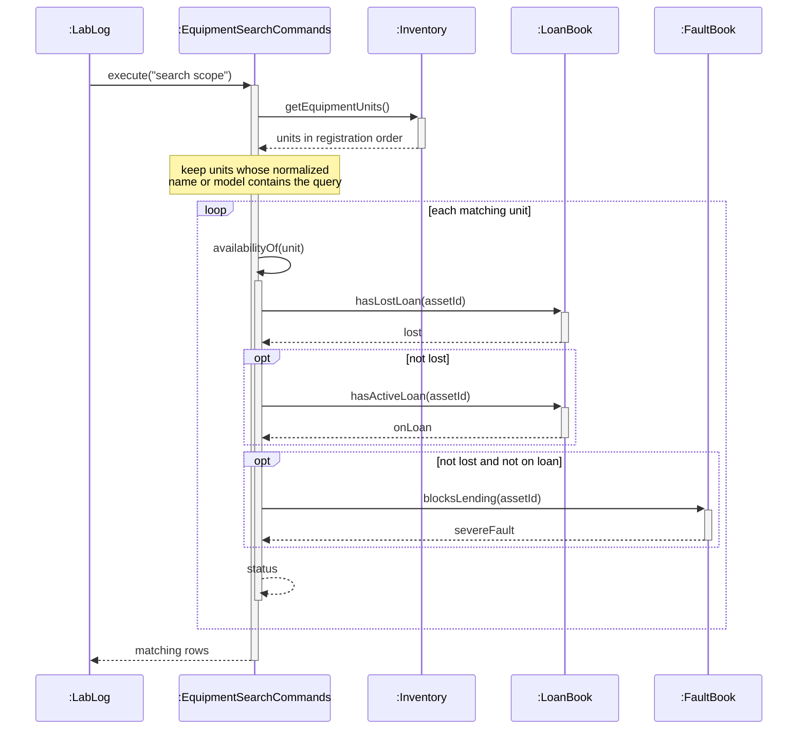

Only matching units are checked, and no message reaches storage, so searching
never changes or saves records. A linear scan is fast enough for a lab inventory
and cannot become stale, unlike an index that every edit would have to update.

### Borrowers

A `Borrower` is an immutable, validated contact record. Loans refer to borrowers
by ID, so `edit-borrower` replaces one record without touching any loan.

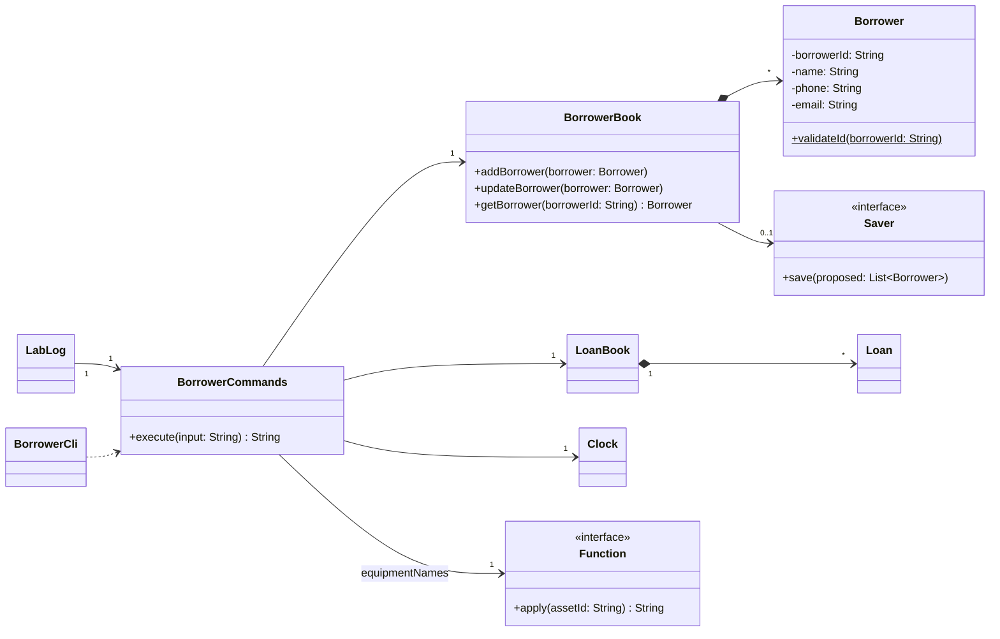

`Function` denotes `java.util.function.Function<String, String>`, and `Saver`
denotes the package-private `BorrowerBook.Saver` interface.

`LabLog` keeps one `BorrowerCommands` and shares its borrower and loan books with
the loan handlers. `BorrowerCli` creates its own `BorrowerCommands` with a
file-backed `BorrowerBook` and an empty `LoanBook`.

#### Registering a borrower

`add-borrower A0123456X n/Jamie Tan p/91234567 e/jamietan@u.nus.edu` registers one
borrower. The fields may appear in any order, each exactly once:

| Prefix | Field | Rule |
| --- | --- | --- |
| (none) | Borrower ID | One uppercase letter, seven digits and one uppercase letter, e.g. `A0123456X`. This checks the shape, not the check letter. |
| `n/` | Name | 1–100 characters with no control characters. Internal spaces and case are kept. |
| `p/` | Phone | Exactly eight digits. |
| `e/` | Email | A lowercase address in the `u.nus.edu` domain. |

Unknown, missing, repeated or empty prefixes are rejected before the book changes.
The `Borrower` constructor enforces the field rules itself, so records loaded from
a file or built by any other caller are also valid. `BorrowerBook` enforces ID
uniqueness, because that rule depends on the collection.

In the main console, `LabLog.load` installs a `Saver` that writes the proposed
borrowers together with all other records:

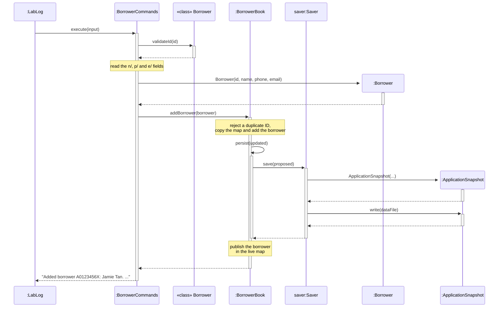

The proposed state is saved before it is published, so a failed write never
registers a borrower only in memory. In `BorrowerCli`, the book has no saver and
writes its own borrower file instead.

#### Listing a borrower's active loans

`loans A0123456X` validates and resolves the borrower first, so an unknown ID is an
error rather than an empty list. The handler reads the shared `LoanBook` on every
call, so a return made by another handler appears on the next listing.

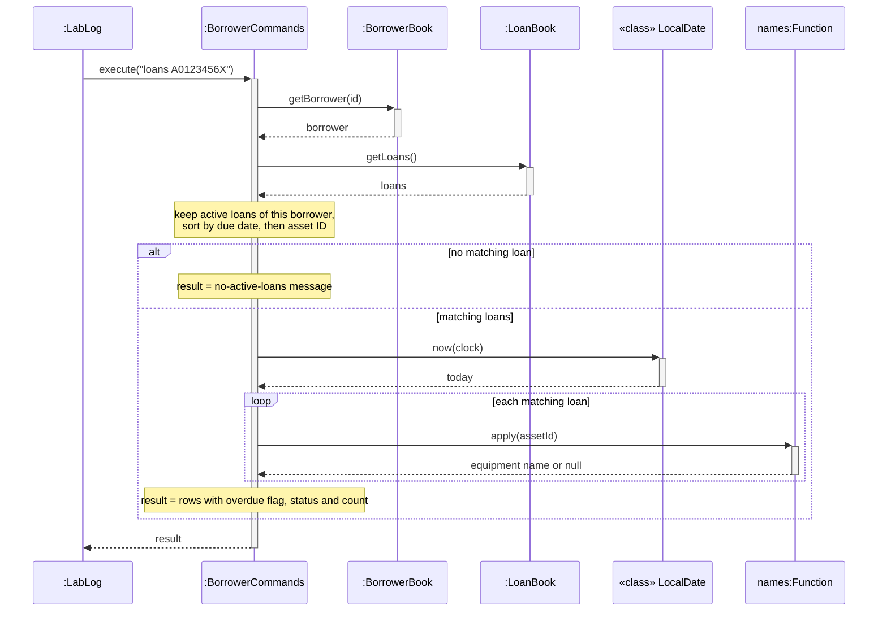

A loan due before today is overdue; one due today is not. A lost loan stays in the
list with status `LOST`, because the borrower is still responsible for it. A
missing equipment record shows `Unknown equipment` rather than hiding the loan.

#### Design choices

| Decision | Reason | Alternative considered |
| --- | --- | --- |
| Validate immutable records in the constructor | Every record is valid, however it was built. | Parser-only validation is shorter but lets file loading create invalid records. |
| Keep borrowers in an ID-keyed map | Duplicate checks and lookups take expected constant time. | A list needs a scan for every lookup. |
| Derive active loans from the shared `LoanBook` | Returns appear immediately with no second copy to synchronize. | A borrower-to-loans index is faster but must be updated by every loan change. |
| Inject `Clock` and the name function | Tests control dates and missing equipment; both consoles reuse the handler. | Calling the system clock and inventory directly makes boundary tests harder. |

### Loans

A `Loan` records one unit lent to one borrower. It is never deleted: returning,
renewing, reporting loss or reversing it changes its state, so history and the
audit log can always find it.

The commands below move a loan between these states. `Loan` validates state
transitions, while `LoanBook` and `BookingAvailability` check correction
dependencies and booking conflicts. Rejected changes throw
`IllegalArgumentException`.

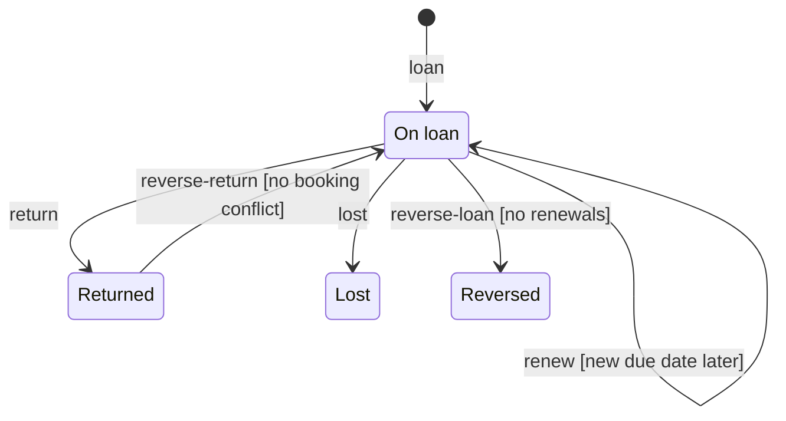

*Each transition is labelled with the command that triggers it and its guard.
`Loan#isActive()` is true in On loan and Lost. A lost loan is still
outstanding, so it stays in borrower and active-loan listings. No command
leaves Lost or Reversed, so they have no outgoing transitions. To reverse the issue of a returned loan, reverse
its return first.*

#### Issuing single and batch loans

`loan ASSET_ID [ASSET_ID ...] b/BORROWER_ID d/DUE_DATE` lends one or more units.
`LoanCommands` reads today's date once, then checks every selection before
creating any loan:

1. every asset ID is registered and appears only once;
2. the borrower is registered and the due date is not before today;
3. the unit has no active loan; the error names the current borrower and due date;
4. the unit has no unresolved severe fault;
5. `BookingAvailability` finds no conflicting reservation or loan in the period
   from today to the due date.

Only after all checks pass does it create the loans and add them to `LoanBook`,
which records a `LOAN` audit event for each. Invalid input or one unavailable unit
therefore creates no partial batch. Lending the units one at a time would publish
earlier loans before a later failure was found.

#### Active and overdue loans

`active-loans` lists active loans; `active-loans overdue` keeps only loans due
before today. Both sort by due date, then asset ID. The handler computes the view
on every call instead of storing an overdue flag, so date changes and returns are
reflected automatically.

#### Renewing a loan

`renew ASSET_ID d/DUE_DATE` extends an active loan. The new due date must be later
than the current one and not before today, so an overdue loan can be renewed. The
whole new period is checked with `BookingAvailability`, ignoring only the loan
being renewed.

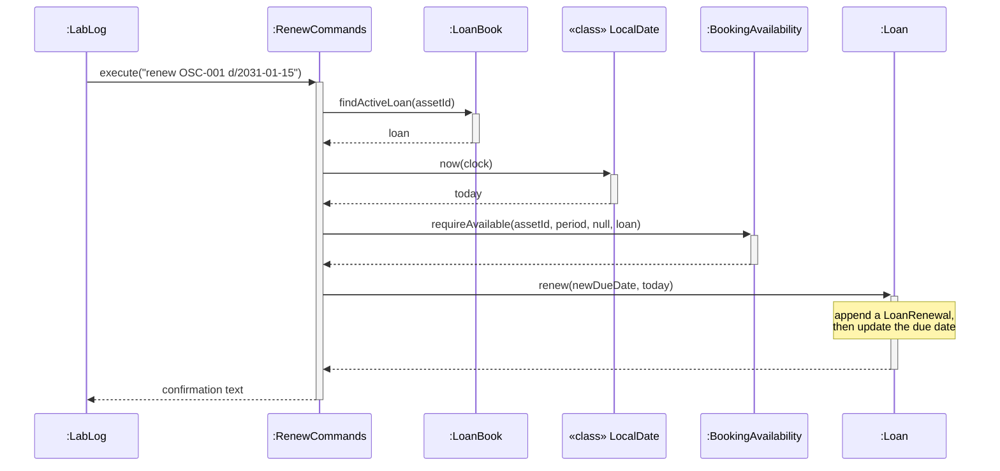

Each accepted renewal appends an immutable `LoanRenewal` holding the renewal date
and the previous and new due dates. Overwriting the due date alone would lose the
evidence needed to show and validate deadline changes. History shows each renewal
as a `RENEWAL` row.

#### Returning equipment

`return ASSET_ID [faults/DESCRIPTION]` returns one unit; `return ID ID ...` returns
several. A fault description is accepted only for a single unit, so each
description belongs to the right loan.

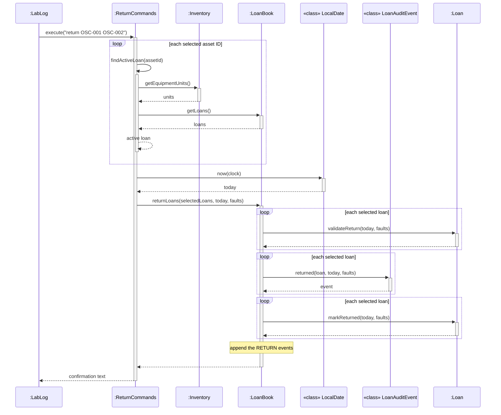

`findActiveLoan` requires registered equipment with exactly one active loan.
`LoanBook.returnLoans` validates every selected loan and prepares every audit event
before changing any loan, so a later invalid selection leaves all units unchanged.

| Aspect | Current choice | Alternative |
| --- | --- | --- |
| Storing a return | Update the existing loan with the return date and fault text. History, listings and the audit log read the same record. | Separate return records would need links and consistency checks. |
| Batch failures | Validate all selections first. A rejected command means nothing changed. | Returning valid units and skipping invalid ones gives partial progress but makes retries confusing. |

Reported faults are stored as text on the loan. They do not create a structured
fault report or clear an existing one.

#### Reporting a lost unit

`lost ASSET_ID` marks the unit's only active loan as lost on today's date. The loan
stays outstanding: it remains in active and borrower listings with status `LOST`,
and normal return and renewal reject it. Treating loss as a return would wrongly
release the equipment and hide the borrower's responsibility.
`BookingAvailability` rejects lost equipment for every date range. Existing
reservations are kept, not cancelled automatically.

### Loan audit trail and corrections

#### Recording evidence

`LoanBook` keeps an append-only list of `LoanAuditEvent` records beside the
loans. Each event has its own ID, the owning loan's ID, the date, its type
(`LOAN`, `RETURN`, `REVERSE_LOAN` or `REVERSE_RETURN`) and copies of the asset,
borrower, due date and return faults at that moment. Later renewals or loss
reports never alter earlier events.

Every loan has a stable `L-` ID, because the asset ID and borrower cannot tell
repeated loans of the same unit apart. The object diagram shows `OSC-001` lent
twice to the same borrower (IDs shortened). Each event finds its loan through
`loanId`; there is no link between events and loans.

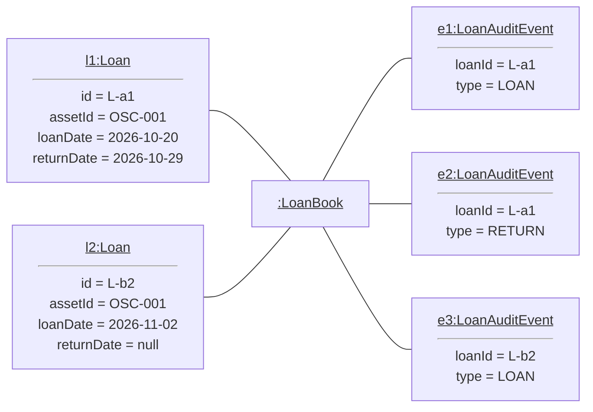

`loan-audit [ASSET_ID]` lists the events, oldest first. A stable sort keeps events
on the same day in the order they were accepted. For example:

```text
lablog> loan-audit OSC-001
Loan audit for OSC-001:

[1] LOAN — 2026-10-29
    Asset: OSC-001
    Borrower: A0123456X
    Due: 2026-12-31
    Event ID: E-4e249542-42e0-4457-9af4-957c7f5a57ca
    Loan ID: L-cac943f8-fe12-4919-a6fa-54355eec7b41

[2] RETURN — 2026-10-29
    Asset: OSC-001
    Borrower: A0123456X
    Due: 2026-12-31
    Faults: Damaged cable
    Event ID: E-9c4091dc-6366-48dd-a8e9-5985068de6dd
    Loan ID: L-cac943f8-fe12-4919-a6fa-54355eec7b41
```

Events are recorded inside `LoanBook.addLoan` and `LoanBook.returnLoans`, so every
issuing and returning path produces evidence. Restoring from a file uses
`LoanBook.replaceAll`, which never invents events. Data saved before format 11
therefore has an empty log.

#### Correcting a mistaken loan or return

`reverse-loan EVENT_ID reason/TEXT` and `reverse-return EVENT_ID reason/TEXT` correct
one earlier event. The event ID identifies the exact operation; an asset ID alone
is ambiguous once a unit has been lent more than once. The original event is
kept, and a new correction event with the reason refers to it.

`LoanBook.reverse` rejects a correction when later records depend on the event:

* A loan can be reversed only while it is outstanding, not lost and not renewed. A
  returned loan needs its return reversed first.
* A later effective loan of the same unit blocks reversal. Audit order separates
  same-day operations. Loans without issue evidence dated on or after the event are
  treated as possible dependencies, because their order within the day is unknown.
* Reopening a return is checked with `BookingAvailability` over the original loan
  period, ignoring only that loan. An overdue loan is checked with no end date.

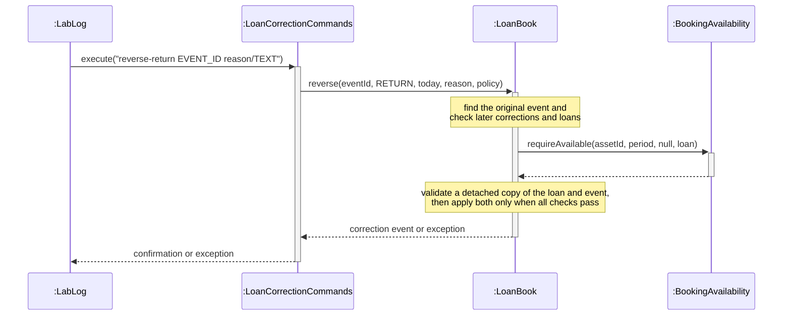

A rejected correction throws `IllegalArgumentException` through the handler to
`LabLog`, which prints the error without saving or displaying success.

`LoanBook` applies the change to a copy and validates the complete set of loans
and events before changing the shared loan. The loan object keeps its identity for
other handlers, and a rejected correction changes nothing. A reversed loan is
excluded from active loans, status and availability checks; history labels it
`REVERSED`.

### Equipment history

`history ASSET_ID` shows every record about one unit, built fresh on each request.

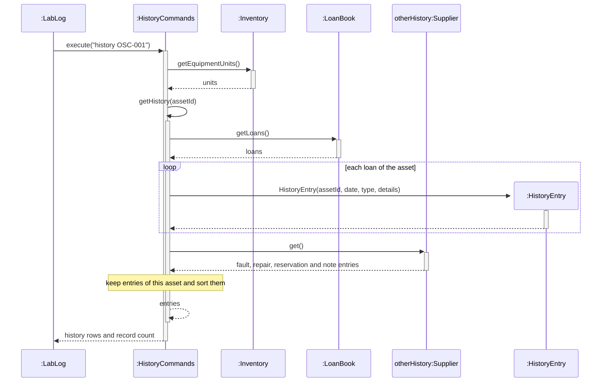

* Loans yield a `LOAN` row with the current state, plus `RENEWAL` and `LOST` rows.
* The supplier, built by `LabLog`, adds fault, repair, reservation, cancellation and
  `reservation`/`maintenance` note entries without coupling `HistoryCommands` to
  those models.
* Entries sort by date, then type (`LOAN`, `RESERVATION`, `FAULT`, `MAINTENANCE`,
  `RENEWAL`, `LOST`), then description. Renewals keep their acceptance order.

Building history on demand means returns and edits appear immediately, with no
cache to invalidate. History is a readable summary; the loan audit trail is the
immutable record of borrowing and returning.

### Faults and repairs

`fault ASSET_ID d/DATE [s/SEVERITY] desc/DETAILS` records a structured `Fault` with
a UUID-based `F-` ID. Severity is `minor`, `moderate` or `severe`; if omitted it is
`UNSPECIFIED`. An unresolved severe fault blocks lending immediately and makes
`list`/`find` show `Unavailable: severe fault`. `FaultBook.blocksLending` and
`getUnresolvedSevereFaults` are the single source of this rule.

`repair FAULT_ID d/DATE desc/DETAILS` resolves one fault. The repair date may not be
in the future or before the report. `Fault.resolve` returns a new immutable record,
so resolution happens once and earlier snapshots are unchanged. History shows the
report and, after repair, a separate `MAINTENANCE` row.

`reservation` and `maintenance` notes (`HistoryRecordCommands`) are display-only
history notes. They do not affect availability.

### Reservations and availability

| Command | Purpose |
| --- | --- |
| `reserve ASSET_ID b/BORROWER_ID from/START to/END` | Book a unit for an inclusive date range. |
| `edit-reservation ID [b/] [from/] [to/]` | Replace a booking; only its own ID is ignored by conflict checks. |
| `cancel-reservation ID reason/TEXT` | Cancel and keep the booking with its reason in history. |
| `available from/START to/END [category/C]` | List units free for the whole range. |
| `why-unavailable ASSET_ID [from/START to/END]` | List every reason a unit is blocked. |
| `wait-request b/ID category/C from/START to/END` | Record demand when no unit of a category is free. |

`DateWindow` is an inclusive date range used by reservations and waiting requests.
`Reservation` and `WaitingRequest` are immutable; edits and cancellations create
replacement records. `ReservationBook` and `WaitingRequestBook` save before they
publish, as described in [Storage](#storage).

**One conflict policy.** `BookingAvailability` decides availability for lending,
renewal, reservations, `available` and `why-unavailable`. `ReservationBook`
creates it, and the two refer to each other.

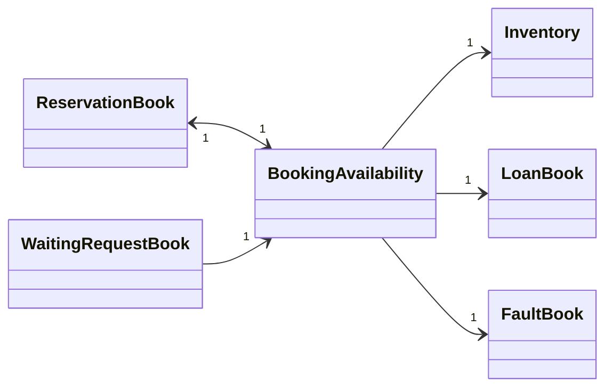

All ranges are inclusive, so touching endpoints conflict:

* a lost unit or an unresolved severe fault blocks every range;
* a confirmed reservation blocks its range, even for the same borrower;
* a loan blocks from its loan date to its return date, or to its due date if still
  active. An overdue outstanding loan blocks indefinitely.

`reasons` collects every blocker in a fixed order; `conflict` returns the first,
and `requireAvailable` throws it. Because lending and the explanation command
share one rule, they cannot disagree. Callers that change an existing booking
pass its reservation ID or loan as the one record to ignore.

Waiting requests record category-level demand only when matching operational units
exist but none is free for the whole range. No unit is allocated automatically.

### Daily overview, help and command recall

**Overview.** `overview` lists today's reservations, overdue loans and unresolved
severe faults. It reads today's date once, so every section uses the same date even
at midnight. It reuses the same rules as the other commands: `Loan.isActive` for
overdue loans and `FaultBook.getUnresolvedSevereFaults` for faults. Maintenance
scheduling is not supported, and the output says so.

**Help.** `HelpCommands` holds shared guidance for both consoles and has no record
dependencies. `help` lists commands; `help COMMAND` shows syntax, fields and
examples. Tests run every documented example against the real handlers.

**Console formatting.** `TableFormatter` aligns listing columns and adds a header
and separator. Equipment lists, search, availability, active and borrower loans,
history, reservations, waiting requests and overview share this formatter.
Reservation and waiting-request tables include a Status column. `help` groups
commands into sections and wraps descriptions; `help COMMAND` retains its border.
Queries have no `[OK]` prefix.

**Command recall.** `CommandHistory` keeps the last 20 commands of the session.
`commands` lists them and `recall INDEX` displays one for copying and editing. A
recalled command is never run automatically, which avoids repeating a change by
accident. Answers to the `add` prompts are not recorded.

## Documentation, logging and testing

**Assertions.** `LabLog` uses `assert` to check internal assumptions, such as only
supported record commands reaching its dispatch helper. User input errors are
always handled by normal validation, which still works when assertions are off.

**Logging.** `LabLog` and `HelpCommands` log rejected input and incomplete
registration at `FINE` level, without raw input or borrower details. To see the
logs with assertions enabled:

```powershell
java -ea -Djava.util.logging.config.file=config/logging.properties -jar build/libs/lablog.jar
```

**Automated tests.** From the repository root with Java 25:

```powershell
.\gradlew.bat test checkstyleMain checkstyleTest shadowJar
python test/run-cli-smoke-tests.py
```

The JUnit suite has one test class per handler or model area, for example
`LoanCommandsTest`, `ReturnCommandsTest` and `SnapshotValidationTest`. Each
feature's tests cover valid input, boundary dates through an injected fixed
`Clock`, invalid input, unchanged records after rejection and, for commands that
change records, persistence after restart and failed saves. The Python runner
drives the packaged JAR in separate processes with temporary data, including
export and import. The PowerShell runner `test/run-borrower-ui-tests.ps1` checks
the exact output of the borrower console. CI runs only the Gradle checks.

## Appendix A: Product scope

### Target user profile

* Laboratory technicians in a university electronics lab who lend individual,
  numbered equipment units to students.
* Manage tens to a few hundred units and hundreds of loans per semester.
* Prefer typing commands to using a mouse, and are comfortable with a command-line
  application.

### Value proposition

LabLog keeps every unit, borrower and loan in one place that a technician can query
quickly from the keyboard:

* see at a glance which units are available, on loan, lost or blocked by a severe
  fault, and why a unit cannot be booked for a date range;
* lend and return several units in one command, with all-or-nothing validation;
* keep a complete history of loans, renewals, losses, faults and repairs for each
  unit, and correct mistakes without erasing evidence;
* plan ahead with reservations and waiting requests checked by the same conflict
  rules as lending;
* keep all data in one portable file that can be exported and imported safely.

## Appendix B: User stories

The v1.0 rows summarize the original baseline. The v2.0 table lists all 33 stories
in the approved allocation. US identifiers refer to the team's planning sheet, not
GitHub issue numbers.

| Version | As a ... | I want to ... | So that I can ... |
| --- | --- | --- | --- |
| v1.0 | new user | see usage instructions | refer to them when I forget how to use the application |
| v1.0 | laboratory technician | register borrowers | retain validated contact details |
| v1.0 | laboratory technician | view active loans and equipment history | track who has equipment and its past loans |
| v1.0 | laboratory technician | record returns and reported damage | close loans while retaining their history |

For each v2.0 story, the user is a laboratory technician.

| Story | I want to ... | So that I can ... |
| --- | --- | --- |
| US06 | copy equipment details to a new asset ID | register identical units without retyping their details |
| US07 | edit equipment details | correct records while preserving their references |
| US08 | record and update storage locations | locate each equipment unit |
| US09 | move several units together | keep locations consistent after a bulk move |
| US12 | receive clear validation errors | correct invalid or incomplete equipment details |
| US13 | be prevented from reusing asset IDs | identify every unit unambiguously |
| US14 | find equipment by exact asset ID | answer a query about one unit |
| US15 | search equipment using partial text | find units when I remember only part of a name or model |
| US16 | filter equipment by category, location and status | identify units suitable for my task |
| US17 | sort equipment by a chosen field | review many records efficiently |
| US18 | view all applicable unavailability reasons | understand why a unit cannot be booked |
| US21 | edit borrower contact details | keep contact information current |
| US25 | issue several units in one operation | serve a borrower without repeating commands |
| US28 | return several units in one operation | process a group of returns consistently |
| US30 | renew an active loan | extend borrowing while retaining deadline changes |
| US31 | list overdue loans in due-date order | prioritize follow-up on outstanding equipment |
| US32 | mark a loaned unit as lost | retain borrower history and prevent lending missing equipment |
| US33 | reverse an erroneous loan or return with an audit record | correct mistakes without erasing evidence |
| US34 | reserve equipment for a period | prepare for a future session |
| US35 | be warned about overlapping reservations or loans | avoid conflicting bookings |
| US36 | edit a reservation period or intended borrower | adapt a booking when plans change |
| US37 | cancel a reservation | release its interval while retaining cancellation history |
| US38 | find units available throughout a time window | select equipment for the whole intended session |
| US39 | record a waiting request for a fully booked category | retain demand that cannot yet be fulfilled |
| US40 | report a fault against equipment | retain an identifiable defect record |
| US41 | record fault severity and description | assess defects and identify severe lending restrictions |
| US44 | record a repair and resolve a fault | retain repair history and remove resolved fault restrictions |
| US58 | view today's reservations, overdue loans and unresolved severe faults | review the day's operational work |
| US60 | inspect chronological borrowing and return evidence | trace operations and corrections without erasing originals |
| US61 | export application data | keep a portable backup of supported records |
| US62 | import valid application data | restore or transfer the complete collection |
| US63 | receive an error for invalid imports without losing current data | correct the file safely |
| US64 | recall and adapt recent commands | reuse input without executing it accidentally |

US58 excludes due-maintenance scheduling: maintenance notes are historical
records, not a schedule. US60 covers borrowing and returning, including related
corrections; it is not a general audit of every inventory-changing action.

## Appendix C: Non-functional requirements

1. Runs on Windows, macOS and Linux with Java 25 and no other installation.
2. Works offline; all data stays in one local, human-readable UTF-8 file.
3. A failed save never corrupts or partially overwrites the previous data file.
4. Invalid commands, imports and data files are rejected before any record changes.
5. A technician who types quickly can complete common tasks faster with commands
   than with a mouse-driven application.
6. Supports one user and one main-console process per data file.

## Appendix D: Glossary

* **Asset ID:** case-sensitive identifier of one physical equipment unit, e.g. `OSC-001`.
* **Active loan:** a loan that has not been returned or reversed. A lost loan is still active.
* **Overdue loan:** an active loan whose due date is before today's local date.
* **Severe fault:** an unresolved fault with severity `SEVERE`; it blocks lending.
* **Inclusive date range:** a range whose start and end dates are both included, so
  ranges that share an endpoint overlap.
* **Snapshot:** the complete set of records saved in, exported to or imported from one file.
* **Snapshot format:** the schema version stored in the `format` key; currently 11.
* **Audit event:** an immutable record of one loan, return or correction.
* **History entry:** a display row built on request, not stored evidence.

## Appendix E: Instructions for manual testing

These are starting points for testers; add your own exploratory tests. Use a new,
empty folder for each round. Dates such as `2030-12-31` are chosen to be in the
future.

### Launch and shutdown

1. Put `lablog.jar` in an empty folder, open a terminal there and run
   `java -jar lablog.jar`.<br>
   Expected: the welcome message and command list appear. No data file is written
   until the first command that changes records creates `data/lablog.properties`.
2. Enter `exit`, then launch again.<br>
   Expected: all records saved in the first session are shown again.
3. Run `java -jar lablog.jar mydata.properties`.<br>
   Expected: records are stored in `mydata.properties` instead.

### Equipment

1. `add OSC-001 n/Digital Oscilloscope c/Electronics m/DS1054Z l/Lab A`<br>
   Expected: `[OK] Equipment added to inventory.`
2. Repeat the same command.<br>
   Expected: `Error: Equipment OSC-001 already exists.`
3. `copy OSC-001 OSC-002`, then `add MIC-001 n/Microscope c/Optics m/CX23 l/Lab B`.<br>
   Expected: `[OK] Copied OSC-001 to OSC-002.` and a third unit.
4. `list category/electronics sort/name`<br>
   Expected: only the two oscilloscopes, both `Available`.
5. `search scope`<br>
   Expected: both oscilloscopes and the microscope, because "Microscope" contains "scope".
6. `find osc-001`<br>
   Expected: `Error: Equipment osc-001 not found.`, because asset IDs are case-sensitive.
7. `add CAM-001`, answer the first prompt, then type `cancel`.<br>
   Expected: `Equipment registration cancelled.` and no new unit.

### Borrowers and loans

1. `add-borrower A0123456X n/Jamie Tan p/91234567 e/jamie@gmail.com`<br>
   Expected: an error asking for a `u.nus.edu` address.
2. `add-borrower A0123456X n/Jamie Tan p/91234567 e/jamietan@u.nus.edu`<br>
   Expected: `[OK] Added borrower A0123456X: Jamie Tan.` followed by contact details.
3. `loan OSC-001 OSC-002 b/A0123456X d/2030-12-31`<br>
   Expected: both units loaned in one confirmation.
4. `loan OSC-001 b/A0123456X d/2030-12-31`<br>
   Expected: an error naming the current borrower and due date.
5. `active-loans` and `loans A0123456X`<br>
   Expected: both list OSC-001 and OSC-002.
6. `renew OSC-001 d/2031-01-15`<br>
   Expected: the due date changes from 2030-12-31 to 2031-01-15.
7. `return OSC-001 OSC-002`, then `return OSC-001` again.<br>
   Expected: both returned, then `Error: Equipment OSC-001 is not currently on loan.`
8. `history OSC-001` and `loan-audit OSC-001`<br>
   Expected: history shows `LOAN` and `RENEWAL` rows; the audit shows numbered
   `LOAN` and `RETURN` events with event and loan IDs.
9. On the same day as the return, `loan OSC-001 b/A0123456X d/2030-12-31`.<br>
   Expected: a conflict error. A returned loan still occupies its return date,
   because date ranges are inclusive. Lend another unit to continue.
10. `loan MIC-001 b/A0123456X d/2030-12-31`, then `lost MIC-001` and `list status/lost`.<br>
    Expected: MIC-001 is shown as `Lost`, and `renew MIC-001 d/2031-01-31` is rejected.

### Faults, reservations and overview

1. `add CAM-001 n/Camera c/Imaging m/A7 l/Lab C`, then
   `fault CAM-001 d/2026-10-01 s/severe desc/Cracked lens` (use a date that is not
   in the future).<br>
   Expected: a fault ID starting with `F-` and severity `SEVERE`.
2. `loan CAM-001 b/A0123456X d/2030-12-31` and `why-unavailable CAM-001`<br>
   Expected: the loan is rejected; the explanation lists the severe fault.
3. `repair FAULT_ID d/DATE desc/Replaced lens` with the fault ID from step 1 and a
   date between the report date and today.<br>
   Expected: the fault is resolved and `find CAM-001` shows `Available`.
4. `reserve OSC-002 b/A0123456X from/2030-01-10 to/2030-01-12`, then
   `available from/2030-01-11 to/2030-01-11`<br>
   Expected: a reservation ID; OSC-002 is not listed as available.
5. `overview`<br>
   Expected: today's reservations, overdue loans and unresolved severe faults.

### Saving, export and import

1. Make a change, `exit`, and launch again.<br>
   Expected: all records are restored.
2. `export backup.properties`, then repeat the same command.<br>
   Expected: the first succeeds; the second refuses to overwrite the file.
3. `import missing.properties --replace`<br>
   Expected: an error and `Current records were not changed.`
4. Exit, open `data/lablog.properties` in a text editor, change `format=11` to
   `format=99` and launch again.<br>
   Expected: `Error: Cannot load LabLog data. Invalid snapshot: Unsupported snapshot
   format; ...` The file is left unchanged.

## Appendix F: Known limitations

* `list` and `find` show today's status and ignore reservations. Use `available` or
  `why-unavailable` to check a date range.
* A lost unit cannot be recovered; no recovery command exists yet.
* Renewals and loss reports cannot be reversed; only loans and returns can.
* The standalone borrower console starts with an empty loan book, so it cannot see
  loans recorded by the main console.
* Only one main-console process should use a data file at a time.
* Fault text entered with `return ... faults/` is stored on the loan; it does not
  create a structured fault report.
