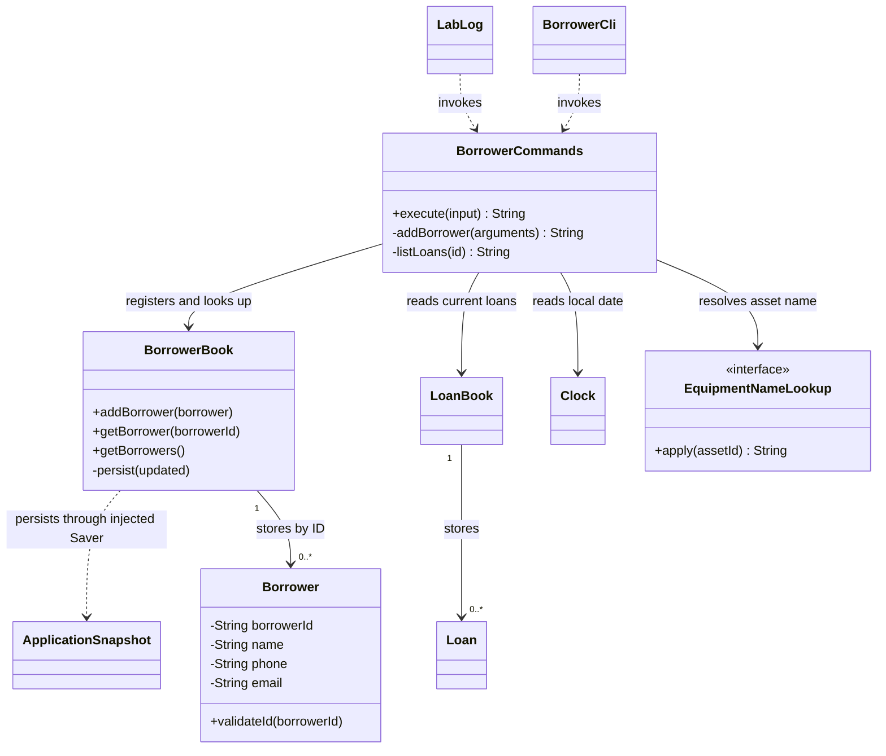
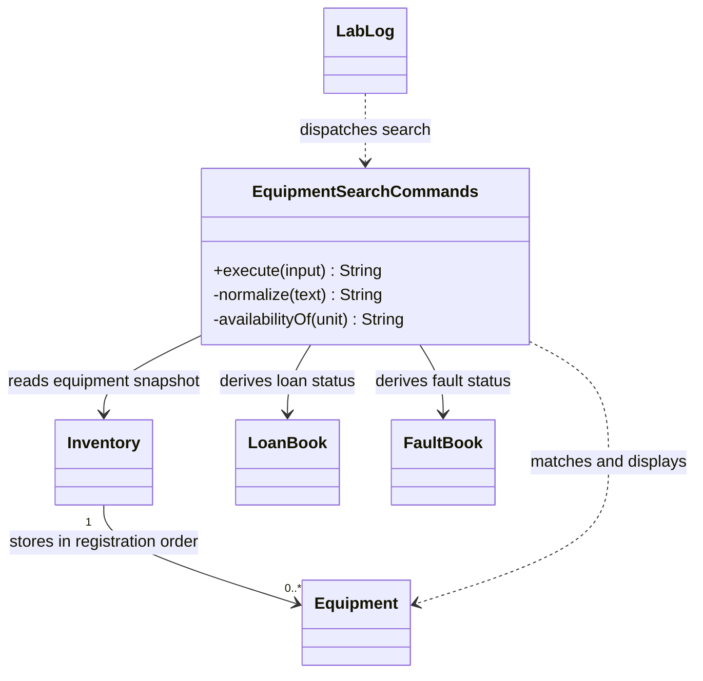
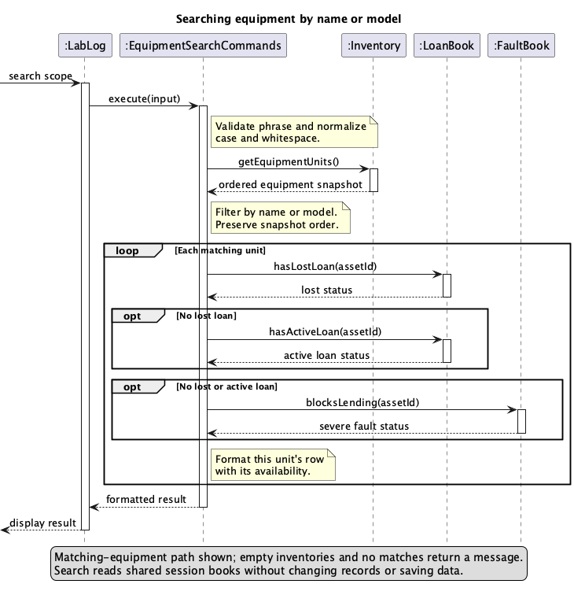
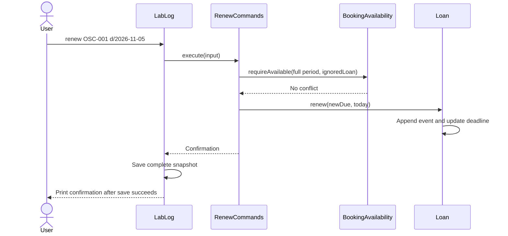
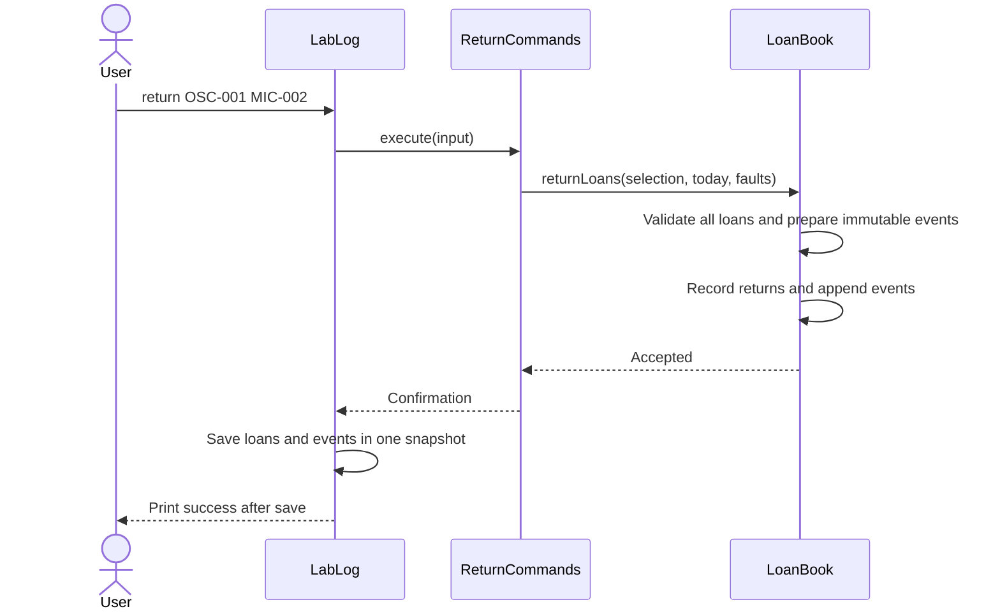
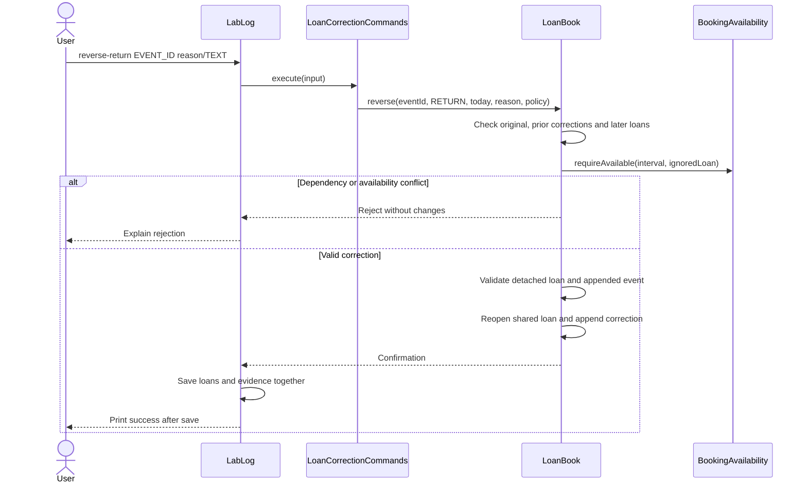

# Developer Guide

## Acknowledgements

LabLog builds on the SE-EDU Java project template. Gradle manages compilation,
JUnit 5 runs tests, Checkstyle checks coding conventions, and Shadow builds the
executable JAR. See `build.gradle` for dependency versions.

## Design & implementation

### Entry points and shared records

The production main entry point loads `ApplicationSnapshot` from `data/lablog.properties`
or the optional command-line file path. It stores equipment, borrowers, loans,
notes, faults, repairs, reservations, waiting requests, renewals, losses and loan
audit events in one format-11 UTF-8 properties snapshot. Save to a temporary file
in the destination directory, then atomically replace the snapshot before
printing success. Unsupported atomic replacement is reported as a save failure;
there is no non-atomic fallback. Save failure stops the session to avoid further
unsaved operations. Legacy split-file installations load the sibling borrower file
and migrate on the next save. Injected constructors remain in memory for unit tests.

Loading rejects missing required fields, invalid dates, duplicate IDs, unknown
equipment references, and multiple active loans per unit. A corrupt file is not
overwritten. This store assumes one application process owns a data file;
concurrent writers are not supported.

`LabLog` is the Gradle application entry point. It routes equipment registration
and copying, listing, active loans, history notes, help, loan, renew, lost, loan-audit,
reverse-loan, reverse-return, history, return,
and borrower commands to their handlers. The prompted and single-line equipment
registration forms both validate before storing. Borrower commands share the
main console's inventory and loan book. Borrowers are part of the complete
snapshot; in-memory constructors remain available for tests.

`BorrowerCli` is a separate entry point backed by a persistent `BorrowerBook`
and an initially empty `LoanBook`. `BorrowerCommands` handles registration,
contact edits, loan listings, and help. Both consoles also support session-only
command recall through `CommandHistory`. The main application wires those handlers to shared
books; [borrower implementation notes](BorrowerImplementation.md) document the
standalone console and original integration increment.

`Equipment`, `Borrower`, and `Loan` model individual records. `Inventory`,
`BorrowerBook`, and `LoanBook` store collections. `LoanBook.findActiveLoan`
returns an `Optional<Loan>`; `hasActiveLoan` reports whether a matching active
loan exists. These are lookup helpers, not an enforcement mechanism:
`addLoan` still permits duplicate active loans, and the loan constructor does
not validate identifiers or dates. `LoanCommands` applies those checks before
storing a record; any other issuing path must repeat them.

### Borrower registration and active-loan listings (Zeph)

This enhancement implements issues #10 and #11: registering a student's contact
details and finding the equipment they currently hold. The design separates
console interaction, command parsing, validated records, and storage so both `LabLog` and
`BorrowerCli` can reuse the handlers. The main console supplies shared borrower,
loan, and equipment records; the standalone console keeps an initially empty loan
book. This section describes registration and listing; contact editing is covered
in [Borrower contact editing](#borrower-contact-editing-issue-89).

#### Responsibilities and relationships

`LabLog` creates shared dependencies and routes borrower commands; `BorrowerCli`
also provides a standalone prompt. Both read complete command lines and print
results or recoverable errors. `BorrowerCommands` interprets those lines and
coordinates the books. `Borrower` is an immutable, validated contact record.
`BorrowerBook` owns the ID-to-record map and optionally persists it. `LoanBook`
remains the source of loan state; borrower records do not contain copied loans.



`EquipmentNameLookup` is a diagram label for the injected
`Function<String, String>`, not an additional Java class. A loan refers to its
borrower by ID, rather than holding a `Borrower` object. The diagram omits getters
and the shared help handler to focus on registration and listing dependencies.

#### Registering a borrower

For example, `add-borrower A0123456X n/Jamie Tan p/91234567
e/jamietan@u.nus.edu` requests one registration. `execute` separates the command
word from its arguments. The registration parser locates whitespace-delimited
prefixes and accepts `n/`, `p/`, and `e/` in any order, exactly once each. It
recognizes unknown prefixes too, allowing it to reject them rather than silently
including them in a name. Missing, repeated, empty, and unknown fields fail before
the book is modified. Surrounding field whitespace is removed; internal name
spaces and letter case are preserved.

The `Borrower` constructor enforces the record's invariants even when a caller
bypasses the command parser. An ID contains an uppercase letter, seven digits,
and an uppercase letter; this is a shape check, not a check-digit calculation.
Names contain 1–100 characters with no control characters. Phone numbers contain
exactly eight ASCII digits, and email addresses use the lowercase `u.nus.edu`
domain and the supported local-part pattern. `BorrowerBook` separately enforces
uniqueness because that rule depends on the collection, not one record.

The following sequence shows a valid registration in the **main console**.
`LabLog.load` installs a `BorrowerBook.Saver` callback that writes the proposed
borrowers together with the other application records. Callback and file
operations are summarized as pseudocode.

```mermaid
sequenceDiagram
    actor User
    participant CLI as LabLog
    participant Commands as BorrowerCommands
    participant Record as Borrower
    participant Book as BorrowerBook
    participant Snapshot as ApplicationSnapshot
    participant Disk as File system
    User->>CLI: add-borrower ID n/NAME p/PHONE e/EMAIL
    CLI->>Commands: execute(input)
    Commands->>Commands: parse and validate prefixes
    Commands->>Record: new Borrower(id, name, phone, email)
    Record-->>Commands: validated record
    Commands->>Book: addBorrower(record)
    Book->>Book: reject duplicate ID; prepare updated map
    Book->>Book: persist(updated)
    Book->>Snapshot: Saver callback captures proposed borrowers and shared records
    Snapshot->>Disk: write temporary snapshot and atomically replace destination
    Disk-->>Snapshot: replacement succeeds
    Snapshot-->>Book: save completed
    Book->>Book: publish record in live map
    Book-->>Commands: addition completed
    Commands-->>CLI: success text
    CLI-->>User: confirmation and contact details
```

Saving the proposed state before publishing it prevents a normal write failure
from registering a borrower only in memory. The temporary file is created beside
the destination so the replacement stays on the same file system. The code
requests an atomic move and deliberately has no non-atomic fallback. If that
operation is unsupported or writing fails, the error propagates to the console
and the live map is not updated. Temporary-file deletion is attempted in a
`finally` block. A cleanup failure can itself propagate as an I/O error; this is
not a general database transaction or a guarantee against every storage failure.

**Standalone storage.** In `BorrowerCli`, each properties key is a borrower ID;
its value contains name, phone, and email
separated by tabs. The model rejects control characters in names, so user data
cannot introduce extra field separators. On startup, a missing file means a new
book. An existing invalid record causes loading to fail rather than being silently
discarded. Reloading uses the same `Borrower` validation as new registrations.
The no-argument book constructor starts in memory; the main application then
installs its snapshot saver. `ApplicationSnapshot` validates the complete stored
state before the main console starts. Legacy split-file data is loaded and
migrated into the complete snapshot on the next save.

#### Listing active loans

`loans A0123456X` first validates and resolves the borrower. A malformed or unknown
ID is an error, distinct from a registered borrower who has no active loans.
The handler reads the shared `LoanBook`, keeps only active loans with the exact
borrower ID, and sorts a fresh list by due date and then asset ID. It does not
reorder the book. Consequently, a return performed through another handler is
visible on the next listing without synchronizing a borrower-specific cache.

```mermaid
sequenceDiagram
    participant CLI as LabLog
    participant Commands as BorrowerCommands
    participant Borrowers as BorrowerBook
    participant Loans as LoanBook
    participant Time as Clock
    participant Names as Equipment-name function
    CLI->>Commands: execute("loans A0123456X")
    Commands->>Borrowers: getBorrower(id)
    Borrowers-->>Commands: registered borrower
    Commands->>Loans: getLoans()
    Loans-->>Commands: current loan records
    Commands->>Commands: filter active loans by ID; sort fresh list
    alt no matching active loans
        Commands-->>CLI: no-active-loans message
    else matching active loans
        Commands->>Time: obtain today's local date
        Time-->>Commands: today
        loop each matching loan
            Commands->>Names: apply(assetId)
            Names-->>Commands: equipment name or null
            Commands->>Commands: append row and overdue indicator
        end
        Commands-->>CLI: rows and active-loan count
    end
```

**Lost loans remain outstanding** and appear with status `LOST`; other
active rows show `On loan`. This keeps unresolved borrower responsibility visible. Ordinary return and
renewal commands reject lost loans; no recovery command is implemented.
A due date before today is overdue; a loan due today is not. Injecting `Clock`
makes this rule testable at local-date boundaries without changing the machine's
clock. The injected equipment-name function avoids coupling the handler to the
inventory's internal representation. A missing equipment record displays
`Unknown equipment`; it does not hide a loan that still needs attention.

#### Design choices and alternatives

| Decision | Reason and trade-off | Alternative |
| --- | --- | --- |
| Validate immutable contact records at construction | Every constructed record has valid fields; edits would require a new record. | Parser-only validation is shorter but allows invalid records through other callers or file loading. |
| Use an ID-keyed map | Duplicate checks and lookups are direct, with expected constant-time lookup. | A list is sufficient for a small dataset but requires repeated scans for IDs. |
| Save a complete proposed snapshot | Atomic replacement keeps proposed borrowers consistent with other records in the main console; the standalone console saves only its borrower book. | A database scales better and provides transactions, but adds setup and dependencies beyond current needs. |
| Derive active loans from the shared book | Returns immediately affect later listings, with no duplicate status to maintain. | A borrower-to-loans index speeds lookups but must stay synchronized with issue and return operations. |
| Inject time and equipment-name lookup | Tests can control dates and missing equipment; the handler is reusable across consoles. | Direct calls to the system clock and inventory are simpler initially but make boundary tests and integration less flexible. |

For `B` borrowers, registration copies O(B) borrower entries. Standalone
persistence writes O(B) records; main-console persistence additionally captures
and writes the other application records, so its cost depends on the full snapshot.
For `L` loans and `K` matching active loans, listing takes O(L + K log K)
time, excluding equipment-name lookup costs, and O(K) temporary list space.
The current book is intended for one console process; atomic replacement does
not provide locking or prevent lost updates between concurrent processes.

#### Failure handling, tests, and integration boundary

The standalone borrower CLI catches `IllegalArgumentException` for invalid
commands and `IOException` for save failures, prints an error, and continues
accepting input. The main console stops on a save failure to avoid further
unsaved changes. Startup load
errors stop the console because proceeding with an empty book could conceal
existing data. Success is printed only after `addBorrower` returns.

`BorrowerBookTest` checks round-trip persistence, failed saves, corrupt existing
records, and unmodifiable snapshots. `BorrowerCommandsTest` covers prefix order,
invalid fields, duplicate IDs, name-length boundaries, unknown borrowers, empty
results, filtering and ordering, local-date overdue behavior, and a return between
two listings. It also checks that the console recovers from a rejected command.
The [console test plan](../test/ui-test-plan.md) covers separate-process checks.

**Integrated workflow.** `LabLog` passes the same borrower and loan books to
issuing, return, and borrower handlers. Its equipment-name lookup reads the shared
inventory. `LoanCommands` validates registered borrowers when supplied with this
book, as it is in the main console. Verify a register, issue, list, return, and
list-again session through that prompt; the second listing must exclude the
returned loan. `LabLogTest` checks borrower dispatch and registered-borrower loan issuing.

`BorrowerCli.main` remains a separate entry point with an empty `LoanBook` and
a name lookup that returns null. It cannot see loans from a different process.
The [borrower implementation notes](BorrowerImplementation.md) describe the
original standalone increment.

### Equipment listing, filters, and sorting

`EquipmentListCommands` accepts `list` with optional `category/`, `location/`,
and `status/` filters, plus an optional `sort/` field, in any order once each.
Category and location compare as exact values without
case sensitivity, and combined filters use AND semantics. The handler filters
an immutable inventory snapshot, preserving registration order unless sorting
is requested. Empty inventories and filters with no matches have
distinct messages; malformed, repeated, and unsupported filters are rejected.

After filtering, `sort/` accepts `asset-id`, `name`, `category`, `model`,
`location`, or `availability`. Comparisons are ascending and case-insensitive,
with asset ID and then exact ID case as deterministic tie-breakers. The handler
sorts a copy of the matching units, so neither filtering nor sorting changes
inventory order or stored records. All options are validated before returning
an empty result, including when the inventory is empty.

Status is the equipment's current operational status, not its availability for
a requested date range. The precedence is `lost`, `on-loan`, `unavailable`,
then `available`: a lost loan yields `lost`; otherwise an active loan yields
`on-loan`; otherwise an unresolved severe fault yields `unavailable`; all
remaining units are `available`. The listing reads the live loan and fault
books. Actual reservations block loans for overlapping date ranges but do not
change this undated status; display-only history notes do not participate in
booking checks.

`EquipmentListCommandsTest` covers each filter, case-insensitive field values,
combined filters and sorting, option ordering, unchanged inventory order,
status changes, invalid inputs, no matches, and severe-fault status filtering.

### Equipment search (US15)

US15 helps a lab technician find a unit by a remembered part of its name or
model. The command accepts a phrase rather than an asset ID, so it complements
`find`, which deliberately performs an exact, case-sensitive ID lookup.
For example, `search scope` can return both a unit named “Digital Oscilloscope”
and a different unit whose model is “ScopeMate”. Search checks names and models
only; it does not search asset IDs, categories or locations. It is read-only:
searching does not edit an equipment record, change a loan, or write the
snapshot file.

#### Responsibilities and relationships

`LabLog` owns the shared `Inventory`, `LoanBook`, and `FaultBook` used by the
main console. It constructs one `EquipmentSearchCommands` with references to
those same books and dispatches input beginning with `search` to that handler.
The handler owns no records. It reads the current equipment snapshot, checks
descriptive fields, and formats the matching rows. For each match, it derives
availability from the live loan and fault books. This keeps the search output
consistent with equipment listing, even after a loan, return, fault report, or
repair in the same session.



The class diagram is Mermaid source in this guide, so its relationships can be
edited directly here.

This class view leaves out command history and snapshot persistence on purpose:
neither participates in a search. The command shares the record books, rather
than copying or maintaining a second search-specific collection. Because the
inventory returns a snapshot, the handler can filter without exposing a
mutable internal list.

#### Parsing and matching

The accepted form is `search TEXT`, where `TEXT` is non-empty and may contain
spaces. The handler trims the command line, checks the command word boundary,
and treats the remainder as one phrase. It collapses runs of whitespace in
both the query and searchable fields, then converts them with
`Locale.ROOT` before comparing. A candidate matches when its normalized name
or model contains the normalized query. This gives case-insensitive substring
matching that does not depend on the user's machine locale. Thus `search Ba`
matches “Basys3”; `search b3` does not, because initials and acronym matching
are outside the current US15 behavior.

The handler scans equipment in the order returned by `Inventory` and does not
sort the matches. This matches the default `list` order and makes results
predictable without an extra ordering option. If the inventory is empty, the
handler returns `No equipment registered.`; if it is non-empty but nothing
matches, it returns a separate message containing the normalized query. A
successful result uses the same columns as `list`: asset ID, name, category,
model, location, and current availability.

The scan is linear in the number of equipment units, with each comparison
bounded by the lengths of the name, model, and query. A precomputed search
index could reduce lookup time for a very large inventory, but would introduce
another representation to update after registration, edits, imports, and
future replacement workflows. For this small command-line inventory, scanning
the authoritative snapshot is simpler and cannot become stale. Adding search
options to `list` was also considered. A separate command keeps free-form
phrases distinct from `list`'s structured exact-value filters and sort options.

#### Availability, errors, and verification

Availability is evaluated only for matching units and follows the shared
priority rule: a lost unit is displayed as `Lost`; otherwise an active loan is
`On loan`; otherwise an unresolved severe fault is `Unavailable: severe fault`;
all remaining units are `Available`. Reservations do not affect this
undated display. Since the handler does not cache status, an earlier search
cannot leave stale values for a later one.

Malformed syntax and an empty phrase raise `IllegalArgumentException` with
usage guidance. `LabLog` catches that expected validation exception at the
command boundary, prints an error, and continues the console loop. The code
does not use Java assertions for input checks: assertions can be disabled at
runtime, so user mistakes must continue to be rejected through ordinary
validation. Nor does the handler catch unexpected runtime failures; allowing
programming errors to surface is preferable to presenting them as normal
no-match results. At present, invalid searches are reported to the console but
do not produce a search-specific `FINE` log entry.



Editable diagram source: [EquipmentSearchSequence.puml](diagrams/EquipmentSearchSequence.puml).

The sequence omits exception details and formatting calls; both are local to
the command boundary and do not change records. The diagram emphasizes the
important data-flow property: only matching rows request availability, and no
message is sent to a persistence component.

`EquipmentSearchCommandsTest` covers partial matches in names and models,
case-insensitive and multi-word queries, whitespace normalization, empty and
unmatched results, malformed input, inventory order, live loan display,
console recovery, and unchanged equipment and loan records. `HelpCommandsTest`
checks that the syntax and behavior described by `help search` remain available.

### Copying equipment

`EquipmentCopyCommands` finds the source by its exact asset ID, rejects unknown
sources and IDs already in `Inventory`, then creates a new `Equipment` with the
source's descriptive fields and the requested ID. It receives only the shared
inventory, so it cannot copy loan or history records. `LabLog` saves a successful
copy through its existing snapshot store before reporting success.

`EquipmentCopyCommandsTest` covers copied fields, unique-ID and source checks,
the unchanged source, persistence, and keeping the original loan and history
records attached to the original ID.

### Help and command examples

`HelpCommands` contains shared guidance for both consoles and has no record
store dependencies. `help` returns a concise list; `help COMMAND` returns
syntax, fields, and explained examples. Invalid names and extra arguments
produce recoverable errors. The loan guidance requires borrower registration.

`HelpCommandsTest` checks parsing, examples against the real handlers, console
integration, and unchanged records/files when viewing help. `LabLogTest` checks
that unavailable commands and invalid initial input do not consume subsequent
commands as equipment details.

### Issuing single and batch loans (issue #71)

`LoanCommands` receives the shared inventory, loan book, and a `Clock`.
`loan ASSET_ID [ASSET_ID ...] b/BORROWER_ID d/DUE_DATE` accepts one or more
whitespace-separated IDs, followed by both prefixes once each in either order.
`readAssetIds` preserves selection order in a list and rejects duplicates using
a set. The command reads today's local date once, checks all equipment references,
validates the borrower and due date, and checks every selected unit's availability.

Active-loan checks use `LoanBook.findActiveLoan`, retaining the warning naming
the current borrower and due date. `FaultBook` rejects unresolved severe faults.
The main console also supplies `BookingAvailability`, which applies the shared
inclusive interval checks to reservations and historical loan occupancy. A
reservation touching the due date is a conflict, including for the same borrower.

`LabLog` supplies its shared `BorrowerBook` to `LoanCommands`, which rejects
unregistered borrowers before recording a loan. The three-argument handler
constructor remains available to standalone callers with their own validation.

Only after every check passes does the handler construct the complete list of
new `Loan` objects and add them to the shared book. Every loan receives the same
borrower, loan date, and due date. Single-unit confirmations retain the equipment
name; batch confirmations list all selected IDs in input order.

This two-phase approach gives validation atomicity: invalid input or an
unavailable later selection creates no partial batch. Repeatedly calling the
single-unit command would publish earlier loans before discovering a later
failure. Existing loans and return details are retained as separate records.

The existing CLI saves the complete snapshot once after the command returns and
prints confirmation only after saving succeeds. On a storage failure the old
saved snapshot remains intact and the session stops; the valid new loans have
already been added in memory, with no in-memory rollback. This differs from
validation failure, which never changes the shared loan book.

`LoanCommandsTest` covers single and batch success, prefix and selection order,
duplicates, date and time-zone boundaries, registered borrowers, and later-unit
failures for unknown equipment, active loans, severe faults, and reservations.
Help tests execute both examples. Storage tests verify shared consumer views
after restart and unchanged snapshot bytes when a batch is rejected.

### Active and overdue loan listings (issue #74)

`ActiveLoanCommands` handles `active-loans [overdue]` using the shared `LoanBook`
and an injected `Clock`. It validates the optional keyword, reads today's local
date once, and selects active loans from the current snapshot. Overdue-only mode
also requires `dueDate.isBefore(today)`, excluding loans due today or later.
Both modes sort by due date and then asset ID for deterministic ties.

The handler computes the view on each invocation rather than storing an overdue
flag, so date changes and recorded returns are reflected automatically. Stream
filtering and sorting leave the underlying loan records and their order unchanged;
the existing read-only CLI dispatch does not save a snapshot. Reloaded loans use
the same query, so the feature needs no storage-format change.

An optional keyword reuses the existing command and display format, keeping the
active-loan and overdue-only rules together. Empty results distinguish
`No active loans.` from `No overdue loans.` Invalid arguments produce
`Use: active-loans [overdue]` and allow the CLI session to continue.

`ActiveLoanCommandsTest` verifies date boundaries, returned-loan exclusion,
due-date and asset-ID ordering, time-zone boundaries, live returns, syntax errors,
CLI recovery, and unchanged persisted records after loading. Help tests execute
both documented examples against the handler.

### Renewing active loans (issue #73)

`RenewCommands` parses `renew ASSET_ID d/YYYY-MM-DD`, resolves an active loan
from the shared `LoanBook`, and reads today's local date once from its injected
`Clock`. The new deadline must be strictly later than the current one and no
earlier than today. Overdue loans can therefore be renewed to today. The handler
calls `BookingAvailability.requireAvailable` with the full proposed loan period
and the original `Loan` as `ignoredLoan`. All other records and unresolved severe
faults still apply; inclusive reservation endpoints conflict even for the same
borrower. No deadline or event changes before validation succeeds.

`Loan.renew` validates domain dates again, appends an immutable `LoanRenewal`
containing the renewal date and previous/new deadlines, then updates the current
deadline. Events retain acceptance order, including multiple changes on one day.
The borrower and issue date remain unchanged. Return validation also rejects a
return before the latest renewal. `HistoryCommands` derives `RENEWAL` rows from
these events, preserving same-day event order. Current loan listings read the
updated deadline from the same loan object.

**Design choice:** Keep structured events within their owning loan. This avoids
ambiguity when the same asset is returned and lent again, even on the same day.
An immutable list snapshot prevents callers from changing earlier events.
Storing only a display note or overwriting the deadline would lose the typed
old/new values needed to inspect and validate the change. This is a renewal
history model; issue #77 adds borrowing/return evidence and issue #76 supplies
the correction workflow.

`LoanRenewalCodec` adds `loan.N.originalDue`, `loan.N.renewal.count`, and indexed
`date`, `previousDue`, `newDue` fields in snapshot format 9. Decode replays each
chain from its original deadline and verifies the final value equals `loan.N.due`.
It rejects missing or unknown fields, invalid counts, backward dates, broken
chains, shortened deadlines, and returns preceding renewals. Formats 2-8 load
with no fabricated renewal events. Complete saves, exports and replacement imports
preserve every event, including events on returned loans.



Syntax, date and conflict failures leave both state and events unchanged. As with
loan/return commands, a storage failure occurs after the in-memory update: the
previous file remains intact, success is suppressed and the session stops.
Restart reloads the previous saved state; no in-memory rollback is claimed.

`RenewCommandsTest` and `LoanRenewalTest` use assertions and fixed clocks for
successive changes, overdue/local-date boundaries, inactive loans, invalid input,
reservation endpoints, severe faults, self-exclusion and history ordering.
`RenewalPersistenceTest` covers restart/export/import, legacy migration, corrupt
chains, return retention, unchanged files after rejection, and failed saves.

### Borrowing and return audit trail (issue #77)

`LoanAuditCommands` implements `loan-audit [ASSET_ID]` over stored evidence,
not derived history text. Its optional asset filter is case-sensitive and requires
registered equipment. Sorting by event date is stable, so events on one day keep
their original acceptance order. Each event is numbered within the displayed
selection and uses separate lines for its details and full identifiers.
The formatter omits blank optional faults, related-event and reason lines.
Queries leave book order and saved bytes unchanged.

Every `Loan` now has a stable `L-` ID. `LoanAuditEvent` is an immutable record
with its own event ID, owning loan ID, local operation date, type, asset, borrower,
due date, return faults, related event ID and correction reason. Event values are
copied at acceptance time. Renewals do not overwrite issue-time deadlines, and
a later loss report does not remove the original borrowing evidence.

`LoanBook.addLoan` prepares a `LOAN` event before adding either record. Keeping
this hook in the book also covers callers issuing a validated batch with repeated
`addLoan` calls. `LoanBook.returnLoans` validates the complete selection, prepares
all `RETURN` events, then changes loan state and appends the evidence in selection
order. `ReturnCommands` delegates to this boundary. Direct `Loan.markReturned`
is used when restoring/testing domain records; it does not fabricate ledger events.

**Design choice:** Store immutable events separately from mutable current loan
state, joined by stable loan IDs. Asset ID, borrower and date cannot identify a
specific loan when the same unit is lent repeatedly. Display notes would lose
structured fields and correction relationships. Date plus stable acceptance
order provides deterministic chronology without inventing time-of-day precision.

Format 11 adds `loan.N.id` and typed `audit.N` fields under `audit.count`.
`LoanAuditCodec` validates unique loan/event IDs, ownership, issue-time facts,
dates and correction relationships before records are published. Corrections
reference an earlier original event on the same loan, preserve its payload and
require a reason; duplicate reversals, forward references and inconsistent event
ordering are rejected. Original events remain present. The model can display and
round-trip correction evidence. `LoanCorrectionCommands` applies reversals and
validates operational dependencies (issue #76); the audit query remains read-only.

Formats 2-10 load with an empty event log and fresh loan IDs. The first successful
save persists those IDs. Restoring uses `replaceAll(loans, events)` rather than
`addLoan`, so no historical issue/return events are invented. A legacy loan can
later acquire an actual return event without an issue event. Complete snapshots,
legacy loan-store saves, export and replacement import all preserve IDs/evidence.
Existing shared book instances are retained across import, so handlers see the
new ledger immediately. Replacement import intentionally replaces the whole log.



Input rejection changes neither loans nor events. As with existing loan/return
commands, a save failure leaves the prior file intact, suppresses success and
stops the session; in-memory state/evidence are not rolled back. Restart loads
the previous saved transaction and its ledger together.

`LoanAuditCommandsTest`, `LoanAuditEventTest` and `LoanAuditPersistenceTest`
cover immutable facts, repeated lending, same-day/batch order, invalid operations,
legacy migration, ID stability, restart/export/import, correction references,
corrupt input and failed saves with assertions. Coverage is collected with a
temporary JaCoCo init script without changing the project's build configuration.

### Correcting erroneous loans and returns (issue #76)

`LoanCorrectionCommands` accepts `reverse-loan EVENT_ID reason/TEXT` and
`reverse-return EVENT_ID reason/TEXT`. It parses one exact original event ID and
one non-empty reason, and dates the correction with the injected local `Clock`.
An asset ID alone is ambiguous when equipment has several historical loans;
the event ID identifies the specific operation to correct. Invalid syntax,
unknown IDs, an incorrect event type and repeated reversals are rejected.

`LoanBook.reverse` resolves the original and checks later dependencies before
changing shared state. Reversing an issue requires an outstanding, non-lost loan
with no renewals. If it was returned, that return must be reversed first. A later
effective loan of the same equipment blocks correction even after its return.
Audit acceptance order distinguishes same-day transactions. Legacy loans without
issue evidence on or after the affected event's date are conservatively treated
as dependencies; the application cannot infer their intra-day order.

For a return reversal, `BookingAvailability.requireAvailable` checks the full
original loan-to-due interval while excluding only the target loan. An overdue
loan is checked through `LocalDate.MAX`, because reopening it restores an
outstanding loan without a known end. Other loans, inclusive reservation
endpoints and unresolved severe faults still block the operation. Independent
bookings and fault records remain unchanged; a correction cannot silently clear
them. Renewals and loss reversals are outside this command's scope.

**State and atomicity:** The book copies the target loan, applies the proposed
transition to that detached copy, prepares an immutable correction event and
validates the complete proposed loan/event graph. Only then does it mutate the
existing shared loan and append the event. This preserves object identity for
other handlers and leaves both collections unchanged after rejection. As with
ordinary loan/return commands, persistence happens before printing success; a
failed atomic save leaves the previous file intact and stops the session, without
rolling back the in-memory transition.

An issue reversal marks the loan as reversed instead of deleting it or pretending
it was returned. `Loan.isActive` excludes reversed loans, all active-loan and
equipment status consumers share that result, and `BookingAvailability` skips
their intervals. `HistoryCommands` labels the original loan `REVERSED`; the audit
view contains the dated reason and reference. A return reversal clears current
return date/faults but retains borrower, identity, deadline and renewals. Original
fault evidence remains in the ledger; a subsequent accepted return creates a
fresh event with a new ID.

Format 11 already represents `REVERSE_LOAN` and `REVERSE_RETURN`, so no new schema
field is needed. `LoanAuditCodec` validates references, effective return details
and active-loan uniqueness. On restore, `LoanBook.replaceAll` derives reversal
flags from validated correction evidence before publishing the records. This
allows a retained reversed loan and a new active loan for the same asset to
round-trip safely. Reversed loans without their correction evidence are rejected.
Legacy loans cannot acquire invented issue events; a newly recorded return on a
legacy loan can still be reversed.



`LoanCorrectionCommandsTest` uses assertions and fixed clocks for both transitions,
same-day ordering, dependent actions, overdue reservations, fault conflicts,
repeated corrections, legacy evidence and shared status/history. Persistence
tests cover restart/export/import, unchanged batch members and rejected files,
projection validation, legacy migration and save failures. Existing audit tests
also verify that corrective evidence agrees with the restored current state.
`LoanBook.validateActionDate` prevents subsequent returns, renewals or loss reports
from being backdated before accepted audit events if the local clock changes.

### Reporting loaned equipment lost (issue #75)

`LostCommands` handles `lost ASSET_ID` using the shared inventory, loan book and
injected local `Clock`. It requires registered equipment and exactly one active
loan. `Loan.markLost` rejects returned/already-lost loans and dates before the
issue date or latest renewal, then sets the loss report date. Borrower, issue date,
deadlines and renewal events remain unchanged.

**State choice:** A lost loan stays active in the sense of outstanding, with a
separate `isLost` flag derived from its report date. Treating loss as a return
would falsely release the equipment and remove it from borrower listings.
`Loan.validateReturn` and `Loan.renew` reject lost records, so batch-return
validation also fails before changing any selected loan. No recovery transition
is implemented in this increment.

`LoanBook.hasLostLoan` supplies the shared loss check. `BookingAvailability`
rejects lost equipment before interval/exclusion checks, even when a caller
passes an ignored loan or a period beyond its deadline. Its `isOperational`
query excludes losses and severe faults from waiting-request capacity. Existing
reservations remain historical/operational records and are not auto-cancelled.

Equipment list/find display `Lost`; the equipment status filter accepts `lost`
and excludes it from `on-loan` and `available`. Severe faults use the
`unavailable` status; `available` excludes both lost and severely faulted units.
Active-loan and borrower-loan
views keep the record and mark it `LOST`. Overdue-only filtering still depends
on the due date, with `LOST` taking precedence in the displayed status. Borrower
rows now have a separate Status column alongside Overdue. History retains the
original loan/renewals and derives a `LOST` row dated on the report day.

Snapshot format 10 adds the required `loan.N.lost` field: an empty string means
no loss, otherwise it is the report date. Decode restores renewals and returns
before applying the loss transition, rejecting contradictory dates or a loss
on a returned loan. Formats 2-9 remain readable without fabricated loss reports.
The closed schema rejects loss fields in older formats and rejects display notes
masquerading as loss events. Complete and legacy loan stores preserve the field;
restart, export and replacement import use the same validated representation.

`LostCommandsTest` covers transitions, local-date boundaries, shared policy,
list/filter consistency, batch-return atomicity and waiting capacity with JUnit
assertions. `LostPersistenceTest` covers full round trips, format-9 migration,
corrupt input, unchanged files after rejection and failed saves. Like loan/return
commands, loss updates occur in memory before save; save failure retains the old
file, suppresses success and stops the session rather than rolling memory back.

### Equipment returns

#### Implementation

`ReturnCommands` records returns using the shared `Inventory`, `LoanBook`, and
an injected `Clock`. It updates the existing `Loan` rather than removing it,
so the same record remains available to equipment history and borrower listings.

The command formats are:

```text
return ASSET_ID [faults/DESCRIPTION]
return ASSET_ID ASSET_ID ...
```

Multiple asset IDs are separated by whitespace and must be distinct. The optional
`faults/` field is accepted only for a single unit; units with newly reported
damage must be returned individually to associate each description with the
correct loan.

The main operations are:

* `ReturnCommands#readAssetIds(selection)` parses the equipment selection, preserves
  input order, and rejects repeated IDs.
* `ReturnCommands#findActiveLoan(assetId)` checks that equipment exists and finds
  exactly one matching active loan, rejecting missing or inconsistent records.
* `ReturnCommands#execute(input)` resolves all selections and validates every loan
  before starting a separate update pass.
* `Loan#validateReturn(returnDate, faults)` checks the active state, return date,
  and fault text without changing the loan. Its package access lets the handler
  validate a batch before applying any returns.
* `Loan#markReturned(returnDate, faults)` calls the same validation method before
  assigning the return fields. The one-argument overload records a return without
  reported faults.
* `Loan#isActive()` reports whether the loan is neither returned nor reversed. Recording a return
  makes the loan inactive without changing a separate equipment status field.

`LabLog` normally supplies `Clock.systemDefaultZone()`. Tests can inject a fixed
clock to control today's local date and verify time-zone boundaries.

#### Example usage scenario

Assume `OSC-001` is registered and has exactly one active loan whose loan date
is no later than today.

1. The user enters `return OSC-001 faults/Damaged cable`.
2. `LabLog` dispatches the command to `ReturnCommands#execute`. The handler
   validates the syntax and optional fault description, then checks the inventory
   for the exact asset ID.
3. The handler reads `LoanBook#getLoans()` and filters for matching active loans.
   It proceeds only when exactly one is found.
4. The handler obtains `LocalDate.now(clock)` and calls
   `Loan#validateReturn(today, faults)` in the validation pass. It then calls
   `Loan#markReturned(today, faults)` in the update pass to record the date and
   fault description.
5. The handler returns confirmation text. In a persistent CLI session, `LabLog`
   saves the updated records before displaying success. If saving fails, the
   session stops and the previous saved snapshot remains unchanged; the in-memory
   loan has already been updated. Injected in-memory sessions do not save.
6. A subsequent history request shows the return date and reported faults on the
   original loan entry. Active-loan and borrower-loan listings exclude that loan.

The following sequence diagram summarises the successful single-unit return
path. Parsing, the preliminary validation pass, and individual accessor calls
are omitted for readability; `markReturned` also validates before updating.


Editable diagram source: [ReturnEquipment.puml](diagrams/ReturnEquipment.puml).

#### Batch return flow and atomicity

For `return OSC-001 OSC-002`, the handler performs the following steps:

1. Parse the distinct asset IDs and reject any `faults/` field accompanying
   multiple selections.
2. Resolve every ID to exactly one active loan. An unknown unit or an already
   returned loan causes rejection before any record is changed.
3. Read today's date once using the injected clock and validate every selected
   loan against that date and an empty fault description.
4. Only after the whole selection passes validation, call `markReturned` on each
   selected loan using the same date. Unselected and historical loans are retained.
5. Return confirmation listing the selected asset IDs in input order. In a
   persistent session, `LabLog` saves the complete equipment and loan snapshot
   before displaying that confirmation.

Validation is all-or-nothing: a failure on a later selection leaves earlier
selections unchanged. This relies on the application's single-threaded command
execution, with no concurrent changes between validation and mutation.

Persistence uses one atomic snapshot replacement for the complete batch. If the
save fails, the prior saved file remains unchanged and the session stops without
displaying success. The in-memory loans have already been updated; there is no
in-memory rollback on a storage failure. Restarting reloads the prior saved state.

#### Invalid commands and exceptional cases

| Condition | Behaviour |
| --- | --- |
| Missing asset ID or unsupported arguments | Reject the command with usage guidance. |
| Repeated asset ID in the selection | Identify the duplicate and reject the entire batch. |
| `faults/` supplied with multiple asset IDs | Ask the user to return units with reported faults individually. |
| Empty or repeated `faults/` field | Request one non-empty fault description. |
| Equipment does not exist | Report that the equipment was not found. |
| No matching active loan | Report that the equipment is not currently on loan. |
| Multiple matching active loans | Ask the user to resolve the inconsistent loan records. |
| Return date precedes the loan date | Reject the return without changing its fields. |
| Fault text contains control characters | Reject the return without changing its fields. |

`LabLog` catches validation exceptions and displays an error while allowing the
user to continue. A repeated return is rejected when no active loan remains.
For batches, any validation failure preserves all selected loans' existing
details. A save failure occurs after the valid returns have already updated memory.

#### Design considerations

**Aspect: How returns are stored**

* **Current choice: Update the existing loan.** Borrowing and return details stay
  together, and history and active-loan listings read the same records. This
  represents one return per loan rather than a detailed sequence of return events.
* **Alternative: Store separate return records.** This could support a richer
  event history, but requires links and consistency checks between loans and
  returns.

**Aspect: How the return date is obtained**

* **Current choice: Inject a `Clock`.** This makes date-dependent tests repeatable,
  including tests around local-date boundaries, at the cost of an extra dependency.
* **Alternative: Read the system date directly.** This needs less configuration,
  but makes date-dependent tests harder to control.

**Aspect: How batch failures are handled**

* **Current choice: Validate all selections before applying any returns.** The
  user can correct a rejected command without first checking which units were
  already returned. Reusing `Loan#validateReturn` keeps the batch's checks aligned
  with `markReturned`.
* **Alternative: Return valid units and skip invalid selections.** This can make
  partial progress, but needs per-unit outcomes and more care when retrying a
  command. A single rejection would no longer mean that all records are unchanged.

Reported faults are stored as text on the loan. They do not create a separate
fault-history note or clear existing equipment faults. The production application
persists loan and return details through `LabLogStore`.

#### Testing

`ReturnCommandsTest` covers optional faults, local-date boundaries, malformed
commands, repeated returns, multiple active loans, invalid return dates, historical
loans, borrower-listing updates, and the return/history console flow. Batch tests
use JUnit assertions to check successful returns, duplicate selections, rejection
of batch fault descriptions, and unchanged records when a later selection has a
future loan date or has already been returned. They verify return fields and
retained records as well as exception messages where relevant.

`LabLogStoreTest#run_batchReturn_persistsBothReturnsAfterReload` drives the return
through the main console with a temporary data file. It reloads the saved store
and verifies both return dates, retained loan fields, and equipment history.

### Equipment history

#### Implementation

`HistoryCommands` reads the shared `Inventory` and `LoanBook`, then constructs fresh
history entries on every request. Both active and returned loans are included.

The command format is:

```text
history ASSET_ID
```

The main operations and records are:

* `HistoryCommands#execute(input)` validates the command, locates the equipment,
  and formats the result.
* The private `HistoryCommands#getHistory(assetId)` collects, filters, and sorts
  entries without modifying the source records or their ordering.
* `HistoryEntry` holds an asset ID, date, type, and description for display.
* `Supplier<List<HistoryEntry>>` supplies current entries from other features.

Returned-loan descriptions include the return date and reported faults, or state
that no faults were reported on return. Asset IDs are matched exactly and
case-sensitively.

#### Example usage scenario

Assume `OSC-001` has a loan that has been returned with the fault description
`Damaged cable`.

1. The user enters `history OSC-001`.
2. `LabLog` dispatches the command to `HistoryCommands#execute`. The handler
   validates the syntax and locates the equipment in `Inventory`.
3. The handler reads the shared loan book and creates an entry for each matching
   loan. Each entry uses the loan date and reflects the loan's current state,
   including the return date and fault description.
4. The handler calls the additional-history supplier and includes entries with
   the same asset ID. In `LabLog`, this supplier combines caller-supplied entries
   with session notes from `HistoryRecordCommands`.
5. The handler sorts the combined entries by date, oldest first. Ties are broken
   by enum type order (`LOAN`, `RESERVATION`, `FAULT`, `MAINTENANCE`), then by
   description.
6. The application displays the equipment ID and name, the `Date | Type | Details`
   rows, and the record count. No save is triggered by viewing history.

The following sequence diagram shows a history request for registered equipment.
Individual field accessors are omitted for readability.


Editable diagram source: [EquipmentHistory.puml](diagrams/EquipmentHistory.puml).

A malformed command is rejected with usage guidance. Unknown equipment produces
an error before history is collected. Registered equipment with no matching
records produces `No history found for ASSET_ID - NAME.` instead.

#### Integration with other features

`HistoryRecordCommands` creates structured faults and reservation/maintenance notes. Other
features can also supply snapshots through `Supplier<List<HistoryEntry>>`. The
supplier must return a non-null list and must not duplicate loans already read
from `LoanBook` or faults already read from `FaultBook`. It should read current records on every call, include relevant
status and end dates in descriptions, and retain closed or cancelled records when
appropriate. Entries may cover multiple assets; the handler filters them.

Use the loan date, reservation start date, fault report date, or maintenance date
as the entry date. Returning equipment changes the original loan entry's
description; it does not add a separate entry dated on the return day.

Shared records can be passed through
`new LabLog(inventory, loanBook, () -> currentHistoryEntries)`, or directly to
`HistoryCommands`. The application combines supplied entries with saved notes
and derived fault/repair history. Notes do not affect equipment availability;
structured unresolved severe faults block new loans.

#### Design considerations

**Aspect: When history is constructed**

* **Current choice: Build entries on each request.** Returns and source updates
  appear immediately without synchronising a separate cache. Each request scans
  the source records and sorts matching entries.
* **Alternative: Cache the combined history.** This could reduce repeated work,
  but every relevant record change would need to update or invalidate the cache.

**Aspect: How other features contribute history**

* **Current choice: Accept supplied `HistoryEntry` snapshots.** The handler can
  display other features' records without depending on their internal models.
  Suppliers must follow the entry contract and avoid duplicate loan entries.
* **Alternative: Read each feature's model directly.** This gives direct access
  to its details, but adds dependencies whenever new record types are introduced.

History summarises current records and adds immutable renewal events and dated loss reports. It is not
the borrowing/return event log; `LoanAuditCommands` displays that separate ledger. Rebuilding ordinary
entries makes updated details visible without preserving all previous versions;
renewal entries explicitly retain each previous and new deadline.

#### Testing

`HistoryCommandsTest` covers all four entry types, asset filtering, returned
loans, fresh source updates, date ordering and tie-breaking, malformed input,
empty and unknown equipment, and console integration with shared records.

## Product scope
### Target user profile

Laboratory technicians managing individual electronics equipment units and
student borrowers through a text interface.

### Value proposition

Keep equipment identity, borrower contacts, and loan history accessible from
the command line. The main console shares records across registration, lending,
returns, and lookups.

## User Stories

|Version| As a ... | I want to ... | So that I can ...|
|--------|----------|---------------|------------------|
|v1.0|new user|see usage instructions|refer to them when I forget how to use the application|
|v1.0|laboratory technician|register borrowers|retain validated contact details|
|v1.0|laboratory technician|view active loans and equipment history|track who has equipment and its past loans|
|v1.0|laboratory technician|record returns and reported damage|close loans while retaining their history|
|v2.0|laboratory technician|inspect chronological borrowing and return evidence|trace operations without erasing originals|
|v2.0|laboratory technician|mark loaned equipment lost|retain borrower history and prevent lending missing equipment|
|v2.0|laboratory technician|renew active loans while retaining deadline changes|extend borrowing without losing renewal history|
|v2.0|laboratory technician|return multiple equipment units in one operation|process a group of returns without repeating the command|

## Non-Functional Requirements

Build and run with Java 25. Keep help read-only and reject invalid borrower and
return commands before changing records. Save borrower additions atomically
before updating memory. These behaviors are covered by automated tests.

Current limitations: the standalone borrower console has its own initially
empty loan book; concurrent writers to the same data files are unsupported.
Return fault descriptions are stored in loan history and do not create a
separate fault note.

## Glossary

* **Asset ID:** identifier of one physical equipment unit.
* **Active loan:** a loan whose return date is absent.
* **Overdue loan:** an active loan with a due date before today's local date.
* **History entry:** a display snapshot of a record, not an immutable event log.

## Instructions for manual testing

### Assertions and diagnostic logging

`LabLog` uses Java `assert` statements to check internal assumptions: only
supported record commands reach its dispatch helper, and equipment detail
collection receives an already validated asset ID. User input errors still use
normal validation, which works even when assertions are disabled.

`HelpCommands` and `LabLog` use `java.util.logging` at `FINE` level to trace help
requests, rejected input, and incomplete registration. Logs omit raw input and
borrower details. Enable assertions and console diagnostics from the repository
root after building the JAR:

```powershell
java -ea -Djava.util.logging.config.file=config/logging.properties -jar build/libs/lablog.jar
```

Enter `help`, `help unknown`, a blank line, and `exit` to see diagnostics on
standard error alongside the usual console output. Without the logging option,
the default Java logging configuration hides `FINE` messages. Gradle's test task
enables assertions by default.

### Automated and manual checks

From the repository root with Java 25:

```powershell
.\gradlew.bat test checkstyleMain checkstyleTest shadowJar
python test/run-cli-smoke-tests.py
```

The Python 3 runner checks the packaged JAR and separate borrower processes with
temporary data. The existing PowerShell 7 runner also verifies exact borrower
output: `pwsh -File test/run-borrower-ui-tests.ps1`. See the
[console test plan](../test/ui-test-plan.md) and
[verification report](../test/verification-report.md).

For a manual main-console check, run `java -jar build/libs/lablog.jar` with a
disposable data-file path, register equipment with `add`, register a borrower
with `add-borrower`, then issue a loan. Check `active-loans`, `loans
BORROWER_ID`, `return ASSET_ID`, and `history ASSET_ID`. Restart with the same
data path to confirm equipment, loans, returns, and borrowers reload. Use a
separate disposable directory to isolate legacy borrower files beside the
LabLog data file.

## Equipment detail editing (issue #62)

EquipmentEditCommands parses optional name, category, model, and location fields
and constructs a fully validated immutable Equipment record. Inventory replaces
the record at its existing position while retaining the same asset ID, so loan
and history references remain valid. LabLog saves the updated equipment through
the existing snapshot store after the command succeeds.

EquipmentEditCommandsTest covers partial edits, field ordering, validation,
stable asset references, and persistence after restart.

## Bulk equipment location updates (issue #64)

EquipmentMoveCommands parses a comma-separated selection and one target
location. Inventory validates every distinct asset ID and constructs all
replacement Equipment records before installing any of them, so an invalid
selection or location leaves the batch unchanged. LabLog then persists the
updated inventory through the existing snapshot store.

EquipmentMoveCommandsTest covers successful partial batch updates, validation
atomicity, stable loan references, and persistence after restart.

## Exact equipment lookup (issue #67)

EquipmentFindCommands resolves one case-sensitive asset ID from the shared
inventory and reports descriptive fields with availability derived from active
loans and severe faults. The lookup is read-only and returns a clear error for unknown IDs.

EquipmentFindCommandsTest covers details, availability, invalid syntax,
unknown IDs, and unchanged equipment and loan records.

## Borrower contact editing (issue #89)

BorrowerCommands parses optional edit fields and constructs a validated immutable
Borrower. BorrowerBook.updateBorrower requires an existing ID and persists a
proposed map before publishing the replacement. Loans refer to IDs, so edits do
not require rewriting loan records. The package-level Saver boundary lets the
main application later save proposed contacts with its complete snapshot.

BorrowerEditTest covers partial/reordered edits, name-length boundaries,
unchanged loan objects, restart persistence, invalid fields, and failed saves.

## Versioned export schema (issue #90)

ApplicationSnapshot captures the supported object graph and uses LabLogStore's
equipment/loan serializer. UTF-8 properties format 11 retains borrower.count and
note.count with indexed fields, structured renewal chains and each loan's loss report date.
audit.count and typed indexed records retain borrowing/return evidence and correction
references, joined to stable loan IDs. The codec validates references and dates
before writing a temporary file and atomically replacing its destination.
The export command requires a new file and protects the active data paths.

Integration contract for domain owners: add full serialization, validation and
round-trip tests for new reservation/audit models, then bump the version.
Do not serialize HistoryEntry display text as a substitute for full domain data.
Import and envelope validation use the same codec as export.

## Import and single-file persistence (issue #91)

LabLog.load reads complete formats 2 through 11 into detached books, or loads the legacy two-file
installation without writing during startup. Main-console mutations persist
one ApplicationSnapshot. BorrowerBook's Saver writes proposed contacts with
the other current records before publishing the edit.

Import decodes all records and validates IDs, references, dates and active-loan
constraints before writing the replacement atomically. Only after persistence
succeeds does it replace the contents of shared books. Existing command handlers
therefore observe the new records without being rebuilt. Injected external
history sources cannot be replaced and are rejected explicitly.

SnapshotImportTest checks valid replacement, visibility through existing
handlers, restart, updated contacts, legacy migration and a failed destination
replacement. An unsupported atomic move fails safely; no non-atomic fallback
is attempted. Use one main-console process per data file.

## Import envelope validation (issue #92)

ApplicationSnapshot.readProperties rejects duplicate properties through a
Properties subclass instead of accepting the parser's usual last-value-wins
behavior. It checks regular-file status and the 10 MiB input limit. Decode
derives the accepted key set from the export schema and the declared input version,
excluding fields introduced by later versions. It rejects supplied keys
outside it, including out-of-range indices. The error names the first unknown
key in sorted order. Required-field validation separately rejects missing keys. Domain validation remains shared with
the export codec.

SnapshotValidationTest supplies malformed versions, counts, contact fields,
dates, references, duplicate IDs/keys, unknown fields, invalid audit data,
invalid UTF-8 and oversized input. Dispatcher-level cases verify saved content
and active-loan listings remain unchanged after each invalid import.


The PR #96 follow-up is covered by
SnapshotValidationTest.decode_unknownProperties_rejectsBeforeReserialization.
It supplies valid snapshot records plus unknown top-level, per-record and
out-of-range indexed properties. Both direct decode and read-then-write must
fail before the existing destination can be overwritten; the source, destination
and input properties are checked for preservation.

## Explicit command recall (issue #93)

CommandHistory intercepts commands and recall before normal dispatch. It keeps
at most 20 submitted top-level lines and returns display text without recursively
dispatching the recalled command. Scanner-based consoles do not support portable
editable terminal buffers, so copying/editing and explicit resubmission is the
documented interaction. No terminal dependency or hidden execution is needed.

CommandHistoryTest covers empty history, invalid/overflowing indices, eviction,
session isolation, wizard-answer exclusion, both consoles and explicit execution
after editing a recalled command.

### Sorting filtered equipment

Use `list [category/VALUE] [location/VALUE] [status/available|on-loan|unavailable|lost] [sort/FIELD]`.
Filtering and sorting can be combined in any order. Sort fields are `asset-id`,
`name`, `category`, `model`, `location`, and `availability`. For example,
`list category/Electronics sort/name` sorts only matching units. Comparisons
are ascending and case-insensitive, with asset ID and exact ID case as tie-breakers.
Sorting a copied snapshot preserves the stored registration order.

## Structured fault reports (issue #85)

`Fault` holds an immutable ID, registered asset ID, report date and description.
`FaultBook` owns the records and checks equipment references and duplicate IDs.
Reports use UUID-based `F-...` IDs to avoid a separate persistent counter.
`getFaults()` returns an immutable snapshot for future overview consumers;
`Fault.toHistoryEntry()` includes the ID without storing duplicated history text.
Issues #86 and #87 add severity, lending restrictions and repair transitions below.

`HistoryRecordCommands` retains the existing fault command syntax and date rules
(including past and future dates). `LabLog` shares the store's fault book and saves
before printing success. A save failure stops the session using the existing
failure policy; the previous saved data remains unchanged.

Format 3 introduced `fault.count` and indexed `fault.N.id`, `asset`, `date`
and `description` fields; formats 4 and 5 extend these records below. The current
writer always saves one complete format-11 snapshot, including borrowers and notes.
Legacy split-file installations migrate on save. Imports replace the existing
shared fault book, so all handlers see replacement faults immediately.
Derived fault history is excluded from exported notes to prevent duplication.

`FaultReportingTest` covers multiple reports, date boundaries, invalid input,
immutable views, stable IDs across restart/export, broken saved references,
duplicate IDs, legacy loading, and failed-save behavior.

## Fault severity and description (issue #86)

`Fault.Severity` defines `MINOR`, `MODERATE`, `SEVERE` and `UNSPECIFIED`. The
optional `s/` field accepts the first three levels case-insensitively, between
`d/DATE` and `desc/DESCRIPTION`. Omission retains the original command syntax
and records `UNSPECIFIED`. Descriptions remain required and single-line; repeated
or misplaced field prefixes are rejected before any record is inserted.

The agreed lending rule blocks equipment with a severe fault. `FaultBook`
provides an immutable `getUnresolvedSevereFaults()` snapshot for US58 and
`blocksLending(assetId)` for loan validation and availability displays. Resolved
faults are excluded from this query. Severity blocks immediately, independent of the report date. Existing
loans and returns remain valid; a return does not resolve a fault.

`LabLog` supplies the same fault book to reporting, loan, list and find handlers.
`LoanCommands` rejects severe faults before adding a loan. Listings show `On loan`
for active loans, otherwise `Unavailable: severe fault` for affected units.
Overview presentation is not implemented by this change; repairs are described below.

Live and export format 4 adds required `fault.N.severity` enum names. Live
formats 1 and 3 and export formats 2 and 3 remain readable. Format 3 faults
migrate to `UNSPECIFIED`, preserving IDs, dates and descriptions. Missing or
unknown severity in format 4 or later is corruption, not a migration default.
The current writer uses format 11, retaining audit evidence, renewal events and loss reports.

`FaultSeverityTest` covers all levels, description validation, immutable overview
results, affected-unit isolation, date boundaries, reports during active loans,
return behavior, restart/export preservation, migration and malformed severity.

## Fault repairs and resolution (issue #87)

`RepairCommands` accepts `repair FAULT_ID d/YYYY-MM-DD desc/DETAILS`. Its injected
clock checks that the date is not in the future in the application's local time
zone. `Fault.resolve` rejects repeat resolution, a date before the report, or
empty/multiline details. It returns a new immutable `Fault`, preserving the report
ID, equipment ID, report date, description and severity. `FaultBook.resolve`
replaces the matching record only after validation succeeds; existing snapshots
retain their original values. Unknown IDs never change the book.

Resolution state is derived from the optional resolution date; an unresolved
record has no date and empty repair details. A resolved record requires both.
There is one terminal unresolved-to-resolved transition. Reopening, editing a
repair and multiple repair attempts against the same fault are outside scope.

`Fault.toHistoryEntries()` returns the unchanged report entry and, after
resolution, a separate `MAINTENANCE` entry on the repair date, linked by fault ID.
`HistoryRecordCommands` supplies these entries to the existing chronological
history display. The overview query excludes resolved severe faults, so loan,
list and find handlers see updated availability immediately without cached state.
Other unresolved severe faults and active loans continue to prevent lending.

`LabLog` saves a repair before printing success. Save failure stops the session
under the existing persistence policy, leaving the prior saved state unchanged.
Live/export format 5 introduced required `fault.N.resolved` and `fault.N.repair` fields;
both are empty for unresolved reports. Resolved records store an ISO date and
non-empty single-line details. Decoding rejects missing fields, partial repairs,
invalid dates and resolution dates before the report. Current-date validation
belongs to the command, not loading, so saved history is independent of the clock.
Live formats 1, 3 and 4 and export formats 2, 3 and 4 remain readable. Older fault
records become unresolved without losing their existing fields. Export stores
domain fields only, avoiding duplicate report/repair notes. Older versions of
the application predating repairs cannot read format 5 or later.

`RepairCommandsTest` covers successful and same-day repairs, immutable original
reports, rejected inputs and transitions, local-date boundaries, multiple severe
faults, active loans, chronology, restart/export, migration, corrupt repairs and
failed saves. Existing equipment-editing tests also verify integration with the
current develop branch.

## Structured reservations (issue #78)

DateWindow defines inclusive LocalDate intervals. Reservation is immutable and
references registered equipment and a borrower. ReservationBook validates IDs
and references, then calls its Saver with a proposed snapshot before publishing
a change. LabLog keeps the same book instance across imports so handlers remain
connected. ReservationCodec writes explicit indexed fields under reservation.N;
format 6 requires reservation.count. Formats 2-5 load with empty bookings, and
legacy notes remain notes. History derives reservation entries from records.

ReservationTest covers invalid and reordered fields, period boundaries, failed
saves, reload/export/import, schema corruption and legacy compatibility. US35
adds the shared conflict policy without changing the interval contract.

## Shared conflict policy (issue #79)

BookingAvailability.conflict/requireAvailable is the shared public boundary for
reservations, loans, RenewCommands and interval queries. All intervals
are inclusive. A renewal caller passes its original Loan as ignoredLoan and the
proposed full loan period; an edit passes only its own reservation ID. Other
records are still checked. Main-console LoanCommands is wired to this policy.
The existing standalone constructors retain their no-reservation behavior.

Restore validates reservation references, IDs and pairwise booking overlaps.
It does not reject persisted bookings merely because a loan later becomes overdue
or a fault is subsequently reported: those are current operational conflicts,
not evidence that historical saved records are corrupt. BookingConflictTest
covers shared endpoints, exclusion rules, returns, overdue loans and lending.

## Editing reservations (issue #80)

ReservationBook.edit creates a replacement immutable record and excludes only
its original ID from BookingAvailability. It validates all proposed fields and
references before calling the existing snapshot saver, then replaces one item.
This keeps old snapshots unchanged and prevents partial edits on validation or
I/O failure. No schema change is needed. ReservationEditTest covers partial edits,
self-exclusion, conflicts, date boundaries, failed persistence and restart.

## Reservation cancellation (issue #81)

Reservation now retains optional cancelledOn and cancellationReason. The
immutable transition preserves the original period, borrower and ID. The book
saves before publication; availability and pairwise validation ignore cancelled
records. History emits both the original booking and a dated cancellation event.
Format 7 requires both cancellation fields (empty for confirmed records), while
format 6 migrates as confirmed. Partial cancellation records are invalid.
ReservationCancellationTest covers release, isolation, repeats, history,
restart/import/export, legacy migration and failed persistence.

## Interval availability queries (issue #82)

AvailableEquipmentCommands delegates to BookingAvailability.availableUnits;
there is no second overlap policy or stored availability flag. It validates the
interval before reading inventory, filters by optional exact category, and
returns an immutable asset-ID-ordered snapshot without persistence or mutation.
AvailabilityCommandsTest covers endpoints, returns, overdue loans, fault repair,
cancellation, invalid queries on empty data, and the persistent CLI path.


## Waiting requests (issue #83)

WaitingRequest is an immutable category-level demand record with a stable ID,
borrower and DateWindow. WaitingRequestBook validates that operational units
exist and BookingAvailability finds none free throughout the interval. Severe
faults alone do not establish booked demand. Identical borrower/category/window
requests are rejected. The saver runs before publication, retaining the prior
collection on failure. No unit is allocated and reservation/loan state is untouched.

Restoration validates identity, borrower references and duplicate demand without
rechecking current capacity: waiting records survive booking cancellations and
category edits. A future allocation workflow can consume these records, but this
feature intentionally has no automatic allocation or request removal command.

ApplicationSnapshot format 8 adds waiting.count and indexed id, borrower,
category, from and to fields. Formats 2-7 decode with empty waiting lists. Schema
history: 3 introduced faults, 4 severity, 5 repairs, 6 reservations, 7 cancellation,
8 waiting demand, 9 loan renewal chains, 10 loss reports, 11 loan IDs and audit evidence.
Every current save/export writes format 11
and retains all these records. Unknown fields and missing required fields remain errors.

WaitingRequestTest covers inclusive boundaries, duplicate and invalid demand,
loan and reservation capacity, failed persistence, independent waiting state,
restart/export/import, corrupt records and format-7 migration. The full Java 25
suite also verifies older migration paths and all previous booking features.

## Daily operational overview (issue #88)

`OverviewCommands` receives the existing ReservationBook, LoanBook, FaultBook and
Clock. `LabLog` wires the same book instances used by the command handlers and
snapshot replacement. The `overview` command is read-only and has no arguments.
It calculates LocalDate.now(clock) once per invocation so all daily predicates
use the same local date, even at midnight.

Reservation rows require a non-cancelled period containing today inclusively.
Overdue rows use Loan.isActive() and a due date strictly before today, matching
ActiveLoanCommands; returned/reversed loans are excluded and outstanding lost
loans remain included. Severe rows use FaultBook.getUnresolvedSevereFaults(),
matching the shared lending restriction without inferring state from history
text. Future-dated severe reports remain blockers and are therefore displayed.

Each section sorts a derived list without changing source order. Reservations
sort by asset/record ID, overdue loans by due date/asset/record ID, and faults by
report date/asset/record ID. Counts represent records rather than distinct units.
No cached summary, availability flag or new serialization fields are needed.
Imports retain shared book identities, so the next query sees replacement data.
Maintenance scheduling is excluded; the view explicitly states that limitation
and never interprets maintenance notes as scheduled work.

OverviewCommandsTest covers empty sections, invalid input, reservation endpoints,
cancellation, overdue boundaries, losses, reversed/returned loans, multiple
severe faults, repairs, renewal updates, midnight time zones, restart/import and
unchanged saved bytes after queries.

## Unavailability explanations (issue #84)

`UnavailableReasonCommands` accepts `why-unavailable ASSET_ID [from/START to/END]`.
It defaults to the injected clock's local date, or validates an explicit inclusive
window with the existing DateWindow and BookingArguments helpers. The start must
not precede today. Unknown equipment and invalid fields are rejected before any
output claiming availability.

`BookingAvailability.reasons` collects immutable explanations from the shared
loan, reservation and fault books in loss/fault/reservation/loan order. It retains
all matching records rather than hiding later blockers. The existing `conflict`
method selects the first reason from that same collection, keeping lending,
renewal, reservation and interval-availability validation on one rule path.
Exclusion arguments still skip the caller's own reservation or loan. No cached
status field or new persistence schema is introduced.

The main console supplies the same BookingAvailability instance used by lending.
Imports replace book contents without replacing their identities, so explanations
reflect replacement records immediately. Queries do not invoke the saver. Loan
return dates remain inclusive; overdue outstanding loans block indefinitely;
losses and unresolved severe faults block every interval. The compact list/find
labels remain unchanged and are not a substitute for an interval explanation.

`UnavailableReasonCommandsTest` covers simultaneous blockers, identifiers and
details, exclusion arguments, exact asset matching, cancellation and repair,
return-day boundaries, indefinite overdue/loss restrictions, local time zones,
invalid input, restart, import and unchanged saved bytes after queries.

## Current integration limits and packaged verification

Equipment list/find labels use loan, loss and severe-fault records but do not
yet consult reservations. BookingAvailability performs the complete interval
check used by lending, renewal, reservations and the available command.
The User Guide documents this distinction; do not treat the list label as a
booking guarantee. Partial-text search and lost-equipment recovery are not
implemented. Explicit loan and return corrections are supported by
`reverse-loan` and `reverse-return`.

The packaged CLI runner exercises all command-help entries and a combined
batch-loan, renewal, loss, return-audit, reservation, waiting-request and
fault-repair workflow. It exports to a path containing spaces, imports into a
new file and compares the queried records across fresh Java processes. It also
checks that read-only queries do not rewrite the source snapshot. Run it after
the shadowJar task; Gradle check and CI currently run JUnit/Checkstyle only.
See the [verification report](../test/verification-report.md) for the checked revision and results.
